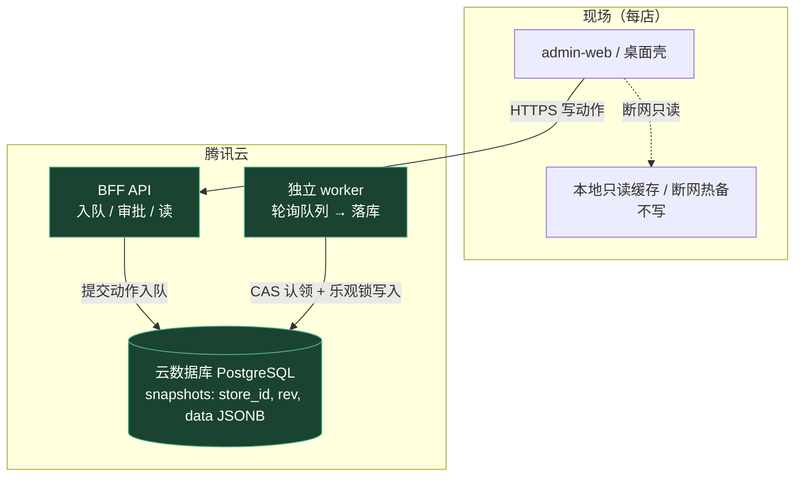

# ADR-010 本地 SQLite 退场与云端单一主存（分期版）

- 状态：**草案（Phase 1–3 未启动）· D0–D3 已拍板（2026-10-28）· Phase 0 接缝层已完成（2026-10-28）· §9 断网政策已拍板「沿用 ADR-009 只读」（2026-10-28）**
- 日期：2026-10-16（初稿）/ 2026-10-28（改写为「接缝先做、云端后接」分期版）/ 2026-10-28（§9 断网政策拍板）
- 关联：ADR-009（服务端为真 / 客户端热备）、ADR-004（写入口 / 队列）、ADR-006（幂等）、ADR-011（schema 版本化）、`docs/治理与待办/redlines.md`（红线唯一权威）
- 前置登记：`docs/迁移基线/欠账总表.md`「执行前置依赖」登记为**未解除偏离**；本版改为**分期解除**

---

## 0. 本版（2026-10-28）变更摘要

1. **拍板 D0**：确定建设**远程中心服务**，云端落**腾讯云**（不是单机本地）。
2. **拍板 D1–D3**（见 §5）：云数据库 PostgreSQL / 独立 worker / 按店迁移切流。
3. **改为分期**：Phase 0 接缝层（**无云权限即可做并本地验证**）→ Phase 1 云端建库 → Phase 2 迁移切流 → Phase 3 本地退场。
4. **修正原草案对现状的误判**（见 §2）：原稿称「店内 SQLite 是生产主账本」，实际桌面端产品的主存是**本地 `snapshot.json`**，`store-node`/SQLite 四件套在桌面端**休眠未运行**。
5. **新增「无云权限」约束下的落地口径**（见 §7）：本地 SQLite 作 dev double、本地 PG 验 D1、云端实现标 `UNVERIFIED`。
6. **拍板 §9 断网政策**：断网**沿用 ADR-009 §2.1 只读**（localStorage 热备、过期即弃），**不做本地离线写**；原「业务待定项」关闭。

---

## 1. 一句话结论

主存最终从「每台终端本地的 `snapshot.json`」迁到「云端 PostgreSQL 单一主存」，但**不一刀切**：先把存储 / 执行器 / 队列抽成可替换的**接缝层**（Phase 0，无需云权限，红线五项在本地即可验证），拿到腾讯云权限后再建库、迁移、按店切流、退场。

---

## 2. 背景与现状（对原草案的修正）

### 2.1 修正：原草案把「休眠的 store-node」误判成「生产主账本」

原稿（2026-10-16）断言：写动作先入云端队列 → 店内消费器拉取执行 → 写店内 SQLite → pusher 推快照，因此「本地 SQLite 是主账本、云端快照是投影」。**这与出厂桌面端产品的实际运行不符**：

- 桌面端（`desktop/electron-main.js`）**不启动 `store-node/consumer`**，并以 `CANTEEN_LOCAL_APPLY=1` 让 BFF 在审批确认后**直接把动作应用到本地 `snapshot.json`**（`routes/actions.js::applyToSnapshot`）。→ 桌面端产品里，**BFF + 本地 `snapshot.json` 就是主存**。
- `bff/store-node/{consumer,pusher,server,db,merge}.js` 是 Python 双机版（`store-inventory`）的**逐行移植遗产**，仅在 `CANTEEN_LOCAL_APPLY=0` 且外部另跑一个店内节点时才启用；默认产品形态下**休眠**。
- `bff/lib/store.js` 是 JSON / JSONL 文件持久化（零依赖），**BFF 侧根本没有 SQLite**；SQLite（`餐厅系统.db`）属于 store-node 侧。

**结论**：真正的「偏离」不是「SQLite 在当主」，而是——**主存在每台终端本地、没有中心化**。用户已选分支 B（建云端中心服务），故要把「本地主」迁到「云主」，并顺带退掉休眠的 store-node 双机机器。

### 2.2 现状与目标

| 项 | 现状（修正后） | 目标（腾讯云） |
|---|---|---|
| 主存 | 每台终端本地 `snapshot.json`（BFF 直接落盘） | **腾讯云托管 PostgreSQL**（每店一行） |
| `snapshot.json` | 权威主存 | 降级为导出 / 缓存 / 离线只读热备 |
| 执行器 | BFF 进程内直接 `applyToSnapshot` | **独立 worker 进程**轮询队列执行 |
| store-node 四件套 | 桌面端休眠；仅外接店内节点时启用 | **退场**（Phase 3） |
| 断网 | 无中心，本机可用 | 只读降级（ADR-009 §2.1），不写 |

---

## 3. 问题定义

- **主存分散**：账本在每台终端本地，多店无法集中、备份 / 审计依赖单机、终端损坏即丢账。
- **单文件无并发语义**：`snapshot.json` 没有 rev / 事务 / 并发控制，不能作多店中心主存。
- **写路径深绑本地**：`applyToSnapshot` 直接写本地文件，功能越叠越难迁。
- 红线五项（写入口 / 审批 / 幂等 / rev / 回滚）必须整体平移到云主存，**一条不松**。

---

## 4. 目标架构（腾讯云）

- **主存表形态**：`snapshots(store_id TEXT PRIMARY KEY, rev BIGINT NOT NULL, data JSONB NOT NULL, updated_at TIMESTAMPTZ)`。
- **乐观锁**：`UPDATE snapshots SET data=$1, rev=rev+1, updated_at=now() WHERE store_id=$2 AND rev=$3`；`rowcount=0` → 409（rev 冲突），直接满足红线「乐观锁 rev」。
- **算法层零重写**：算法仍接收整份 `data` 对象，只是「整库文件」换成「每店一行 JSONB」。已知上限见 §10。

---

## 5. 已拍板决策（D0–D3）

| 编号 | 决策（已定） | 说明 / 落点 |
|---|---|---|
| **D0** | **建设远程中心服务，云端落腾讯云** | 分支 B。多店集中、单一主存在服务端。 |
| **D1** | **云数据库 PostgreSQL（腾讯云托管）**；每店一行 `data JSONB` + `rev` 列，`UPDATE ... WHERE rev=?` 做乐观锁。备选：TDSQL-C PostgreSQL（Serverless，存算分离、按量计费）。 | 保住 rev 语义、算法零重写，同时拿到托管 HA / 备份。**不选**自管 SQLite（单写者、无托管 HA / 备份，与「云」诉求背离）。 |
| **D2** | **独立 worker 进程**（与 BFF 同机不同进程）轮询 DB 队列执行落库；BFF 只入队 / 审批 / 读。v1 单 worker，**不引入** SCF / TDMQ / K8s。 | 幂等重试 / 回滚需要执行体脱离请求生命周期；导入 / 重算类长动作不阻塞 API；可复用 `consumer.js` 轮询骨架。 |
| **D3** | **按店粒度**迁移历史 → 切流后只写云端；**严禁双写**；断网按 ADR-009 §2.1 只读。 | 两个主 = split-brain / rev 分叉 / 回滚失效。测试阶段无真实历史，D3 可整体后置。 |

> **与 ADR-009 的关系**：ADR-009 §2.1 定「服务端主存 + 客户端 localStorage 热备」；本 ADR **不改这条原则**，只把「服务端主存」的**存储形态**从「单文件 `snapshot.json`」升级为「PostgreSQL」。localStorage 仍只读。

---

## 6. 分期路径（核心）

| 阶段 | 目标 | 改什么 | 验收 | 需云权限 |
|---|---|---|---|---|
| **Phase 0 接缝层** | 把存储 / 执行器 / 队列抽成可替换接口；红线五项本地可验证 | ① 抽 `StoreAdapter` 接口（`readSnapshot` / `casWrite` / `enqueue` / `claim` / `appendAudit`）；② `store.js` 直写与 `actions.js::applyToSnapshot` 收口到接口后；③ worker 做成可独立启动模块；④ 队列从 JSON 文件抽象成**表**（本地 SQLite）；⑤ 写「接口契约测试」（本地 SQLite + 本地 PG 同一套断言） | 本地双进程（BFF + worker）跑通「入队→审批→执行→rev 递增」；红线五项本地全绿；契约测试 SQLite / PG 双绿 | **否** |
| **Phase 1 云端建库** | 真正接腾讯云 PG | ① 开 PG（选型见 D1）；② 实现并**验证** PG Adapter（JSONB / CAS / 连接池 / TLS / 重试）；③ 云端 BFF + worker 部署（CVM 或容器）；④ 契约测试对真库跑通 | 云库可读写、rev 正确、`casWrite` 冲突返回 409；`UNVERIFIED` 项转 `VERIFIED` | **是** |
| **Phase 2 迁移 + 按店切流** | 把每店本地 `snapshot.json` 一次性灌库并切主 | ① 迁移脚本（`snapshot.json` → `snapshots` 行）+ dry-run；② 店级开关 `master=cloud`（迁移完成才切）；③ 切流后桌面**禁本地写** | 迁移后 rev 单调、账本一致、回滚可用；无双写 | **是**（+业务窗口） |
| **Phase 3 本地退场** | 清理本地主路径与休眠双机机器 | ① 删 / 废弃 `store-node/{consumer,pusher,server,merge}.js`；② 解 R3 / R4 哈希锁；③ 移除 `CANTEEN_LOCAL_APPLY`；④ 桌面 BFF 改为云端客户端（+只读缓存） | `redline_guard` 全绿；无任何本地写账本路径 | **是**（云链路稳定后） |

**切流铁律**（Phase 2）：切流点之后的新写只进云端；切流点之前的历史只迁移不重放。**禁止双写**。

---

## 7. 无云权限期间的边界（测试阶段）

**现在只做 Phase 0**，Phase 1–3 全部后置。硬边界：

1. **运行时主存不动**：测试阶段产品继续跑本地 BFF + `snapshot.json`，不切云。
2. **本地 SQLite 只是 dev double**：Phase 0 的本地实现用 SQLite（`node:sqlite` 内置、零安装）**仅用于开发 / 契约测试**，不是新主存、不进生产。可直接复用 `bff/store-node/consumer.js::makeSqliteStore` 已有的 `ctx.store` 契约实现。
3. **本地 PG 可装（非云）**：Windows 安装包或 Docker 起一个本地 PostgreSQL，用来验证 D1 的 PG 实现、JSONB、CAS 并发——**没云权限 ≠ 验不了 PG**。
4. **云端实现可先写，但必须标 `UNVERIFIED`**，不得计入「已完成」。

### 7.1 未验证清单（拿到腾讯云权限后必须补）

- [ ] PG `JSONB` 行为与 `UPDATE ... WHERE rev=?` 真实并发 / CAS
- [ ] 连接池、TLS、超时重连、安全组 / 白名单
- [ ] 多实例 worker 的 `claim` 竞争（本地 SQLite 是串行模拟，不代表线上）
- [ ] 迁移脚本在真库上的表现（含大快照）
- [ ] 云上部署形态、备份 / 恢复演练
- [ ] 腾讯云托管 PG 的具体版本 / 参数 / CAM 鉴权

---

## 8. 红线落点迁移（五项不松）

红线对象是「账本」不是「库」；账本从终端本地移到云端 PG，五项**只换落点、不松约束**：

| 红线短名 | 迁移前落点（终端本地） | 迁移后落点（云端 PG） | Phase 0 可本地验证 |
|---|---|---|---|
| 唯一写入口 | BFF `applyToSnapshot` 写本地文件 | worker 写云端 PG | ✅ |
| 审批留痕 | 审批中心确认后落本地 | 同前，落点换云端 | ✅ |
| 幂等去重 | 队列两级去重 | 同前（DB 唯一约束） | ✅ |
| 乐观锁 rev | 本地文件 rev | `UPDATE ... WHERE rev=?` | ✅ |
| 可回滚留痕 | 本地快照历史 + 审批回滚 | 云端主存留档 + 审批回滚 | ✅ |

机械判定联动：R13（后台禁旁路写）落点从本地库改云端库；R3 / R4（`store-node` 哈希锁）随 Phase 3 退场解除；R15（只读零写库）语义不变。

---

## 9. 断网降级口径（**已拍板：只读**）

- **决策（2026-10-28 拍板）**：沿用 ADR-009 §2.1——断网**只读**（localStorage 热备份，过期即弃），**不做本地写**。与 §5 D3「断网按 ADR-009 §2.1 只读」、§2.2 表格「断网 → 只读降级，不写」一致；原「业务待定项」由此关闭。
- **明确不做**：本地离线写队列 / 离线开单记账。理由：离线期即双源，必须做冲突合并，**与 §6「严禁双写」直接冲突**；ADR-009 §2.1 已把客户端定位为「只读暖备」，任何写仍只走服务端队列（红线 ① 唯一写入口）。
- **已知代价（接受）**：断网期间门店**不能开单 / 记账 / 审批落库**，只能读上次快照；动作停在队列不丢（24h 才过期），网络恢复后消费器自动续跑，属**时延不是丢数据**（见 `待治理-审批中心语义澄清与状态枚举双轨.md` §4.2）。
- **变更门槛**：若将来业务反悔要求「离线可写」，**必须另立 ADR** 定义离线队列、冲突合并、rev 分叉处理，并同步修订本 ADR §6「严禁双写」与 D3 口径；**在本 ADR 生效期内不承诺离线写**。
- **口径归属**：ADR-009 §2.1 是唯一权威，本节只确认「云主存形态下沿用该原则」，不新立断网原则。

---

## 10. 对功能层（销售 / 采购）的影响与已知上限

- **算法层零重写**：销售 / 采购执行器仍走现有队列（ADR-009 §2.3「三域一套状态机」），只换**存储适配层**。
- **已知上限（需监控）**：算法是「整份 `data` 载入内存 → 改 → 整份写回」。落到「每店一行 JSONB」后，每次动作＝**整行 JSONB 重写**。单店中小数据量无碍；单店数据（多年销售明细）暴涨后会变慢，届时需拆**行级业务表**（第二次重构）。Phase 0–2 不为性能提前拆行，以保住算法零改动。

---

## 11. 验收标准

**Phase 0（当前）**

1. `StoreAdapter` 接口存在，`store.js` / `actions.js` 无绕过接口的直写。
2. 本地双进程跑通「入队→审批→执行→rev 递增」，红线五项本地全绿。
3. 契约测试在本地 SQLite + 本地 PG 双绿。

**整体（Phase 1–3 完成后）**

1. 云端 PG 是唯一主存，`snapshot.json` 仅为导出 / 缓存 / 只读热备。
2. 一条写动作从入队到落云全程可审计、幂等、rev 正确、可回滚。
3. `redline_guard` 全绿，且无任何本地写账本路径。
4. 断网只读降级可用（§9 已拍板口径），本地不产生账本语义写。
5. §7.1 未验证清单全部转 `VERIFIED`。

---

## 12. 不做什么 / 风险

**不做**

- ❌ 双写过渡（两个主 → split-brain）。
- ❌ 提前上 SCF / TDMQ / K8s（v1 单 worker 足够）。
- ❌ 提前做行级表重构（保住算法零改动）。
- ❌ 在没接缝的情况下先写 PG 专用 SQL 并渗进业务层。

**风险**

- 本地替身跑通 ≠ 云链路已验证：**必须区分「已验证 / UNVERIFIED」**，别让未验证混进「已完成」。
- 桌面端「由主降为客」是隐性大工作量（`electron-main.js` 启动 / 数据目录、`actions.js::applyToSnapshot`、多店身份 / 鉴权），原稿 §6 未覆盖，本版 §6 Phase 3 已列入。

---

## 13. 执行前置依赖登记（欠账总表联动）

`docs/迁移基线/欠账总表.md` 中「数据终点迁移」一项由「未解除偏离」改为**分期解除**：

- Phase 0 完成 → 登记「接缝层就绪（adapter / worker / 契约测试）」；
- Phase 1–3 完成 → 「偏离解除」。

---

## 14. 实施状态

### Phase 0（2026-10-28 已完成）

- `bff/lib/store-adapter/{index,json,sqlite,pg}.js`：StoreAdapter 接口 + JSON（生产默认，行为不变）/ SQLite（本地替身）/ PG（占位，`UNVERIFIED`）。
- `bff/lib/action-runner.js`：执行 + 乐观锁落库核心（路由与 worker 共用）；`applyToSnapshot` 由「盲写 rev+1」改为 `casWrite(rev)`，冲突返回 409。
- `bff/lib/worker.js`：独立 worker（claim → 执行 → ack，含重试上限与终态驳回），CLI 支持 `--once/--interval/--adapter/--db/--limit`。
- `routes/actions.js`、`routes/snapshot.js`：队列与快照读写收口到适配器（默认 json 与旧实现等价）。
- `bff/lib/store-adapter/contract.test.js`：同一套断言跑 json + sqlite（36 项）+ worker 端到端，已接入 `npm test`。
- 回归：`bff` 全量 `npm test` 通过（算法 26/26、路由、store-node、schema、契约测试）；桌面副本已 `sync-assets --only=bff`（+6 ~3）。

**未做（属 Phase 1，需腾讯云权限）**：PG 真实现与真库契约测试、云端部署、§7.1 `UNVERIFIED` 清单验证。
