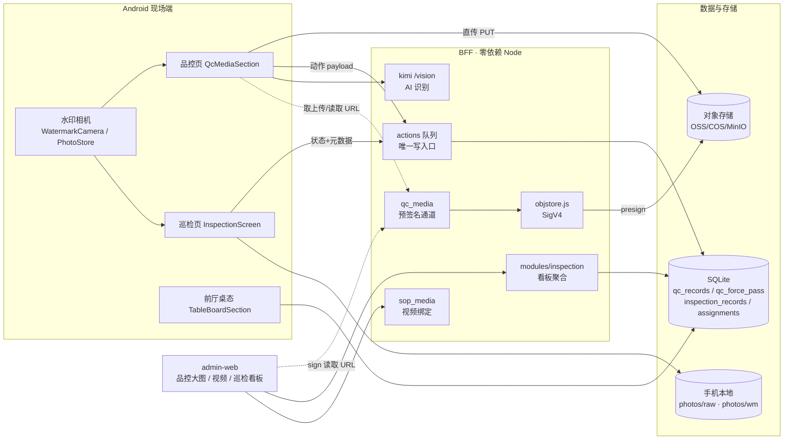
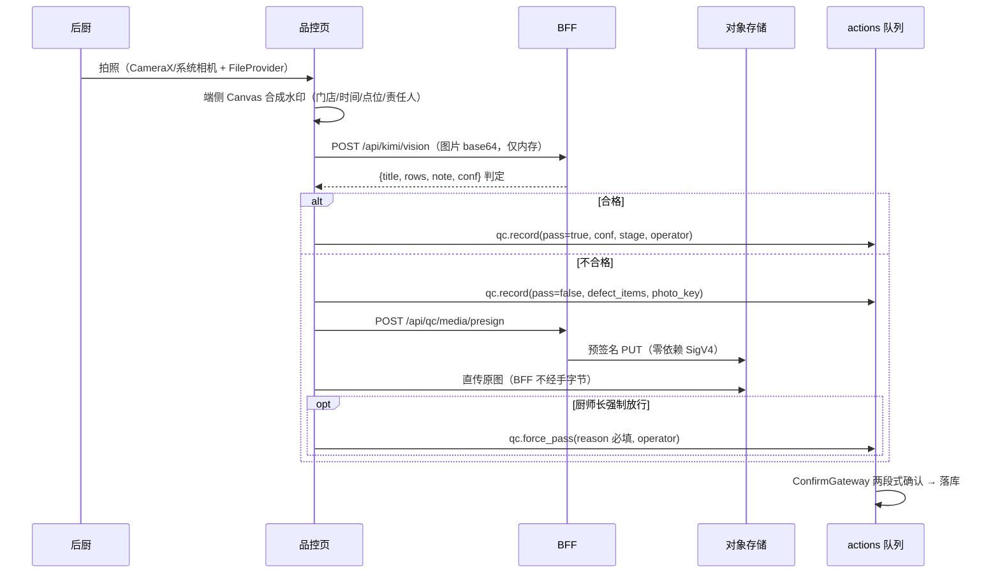
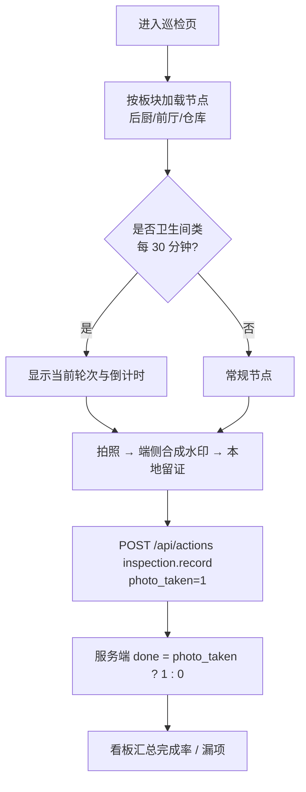
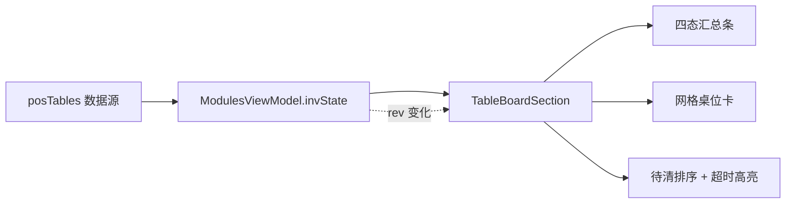

# 现场管理四块能力 · 架构设计

> 适用版本：`main`（2026-09-29）
> 文档类型：模块设计说明（对应 `store-inventory/docs/modules/_TEMPLATE.md` 结构）
> 关联决策：[`ADR-005`](decisions/ADR-005-现场管理媒体与写回边界.md)

本文件描述移动端「现场管理」四块能力的**系统边界、数据流、接口契约与责任划分**，供后续维护者快速定位改动面。四块能力：

| 代号 | 能力 | 主要载体 |
|---|---|---|
| A | 后厨 AI 品控（拍照→识别→判定→留痕） | Android 品控页 + BFF 品控媒体通道 + admin-web 大图台账 |
| B | 前厅桌态看板（四态网格 + 待清排序） | Android 前厅页 |
| C | 闭店巡检（50 节点拍照验证） | Android 巡检页 + BFF 巡检端点 |
| D | 水印相机（端侧合成 + 本地留证） | Android 媒体层 |

---

## 1. 模块职责

| 组件 | 职责 | 明确不做 |
|---|---|---|
| Android 端 | 拍照、端侧水印合成、AI 识别触发、现场判定与确认入队、本地照片台账 | 不判权（读服务端权限）、不直接写库 |
| BFF 品控媒体通道 | 只签发对象存储 URL；拒收图片字节 | **不接触、不落盘、不入库任何图片本体** |
| BFF 动作队列 | 承接全部写操作（品控结论 / 强制放行 / 巡检记录 / 指派） | 不新增直接写库路由 |
| BFF 巡检算法 | 50 节点主数据、完成度判定、30 分钟轮次、板块分工 | 不校验照片内容（照片不上云） |
| admin-web | 品控大图与台账、视频教材绑定、巡检统筹看板 | 不上传品控原图（仅签发读取 URL） |

---

## 2. 系统上下文



---

## 3. 关键流程

### 3.1 A 品控：拍照 → 识别 → 判定 → 落库



> 若对象存储未配置：跳过直传，`photo_url` 留空，识别与结论照常落库；admin-web 显示「图片不可用」。

### 3.2 C 巡检：50 节点拍照验证



### 3.3 B 桌态：看板数据流



---

## 4. 数据模型与接口契约

### 4.1 表结构（迁移 003 / 004）

**`qc_records` 扩展列**（`store-inventory/migrations/003_qc_media.sql`，**不修改既有列**）：

| 列 | 类型 | 含义 |
|---|---|---|
| `defect_items` | TEXT | JSON 数组：裂纹/开口/花纹不符/褶纹/色泽/形态/重量偏差… |
| `stage` | TEXT | 所属工序环节 |
| `operator` | TEXT | 责任人 |
| `photo_url` | TEXT | 对象存储引用（图片本体不入库） |
| `photo_key` | TEXT | 对象键，便于重新签发访问 URL |
| `conf` | REAL | 识别置信度 0–100 |
| `manual_review` | INTEGER | 1=置信度不足，须人工复核 |
| `station` | TEXT | 门店点位/工位 |
| `store_id` | TEXT | 门店标识 |

**`qc_force_pass`**（强制放行留痕）：`id, workorder_id, reason, operator, ts, source`。

**`inspection_records`**（`004_inspection.sql`，**无任何图片列**）：`date, node_id, node_name, board, node_group, every30, round, photo_taken, done, photo_local_only, operator, store_id, station, note, ts, source`。
- 关键不变式：`photo_taken=0 ⇒ done=0`；上层误传图片载荷时 `photo_local_only=1`。

**`inspection_assignments`**（板块分工）：`board, operator, store_id, ts, source`。

### 4.2 HTTP 接口

| 方法 | 路径 | 说明 | 证据 |
|---|---|---|---|
| GET | `/api/qc/media/status` | 媒体可用性（`configured/missing`） | `bff/routes/qc_media.js:88` |
| POST | `/api/qc/media/presign` | 签发上传 URL | `bff/routes/qc_media.js:94` |
| POST | `/api/qc/media/sign` | 批量签发读取 URL | `bff/routes/qc_media.js:162` |
| GET | `/api/kitchen/qc` | 品控台账（含扩展字段三色） | `bff/routes/kitchen.js` |
| GET | `/api/modules/inspection` | 巡检统筹看板 | `bff/routes/modules.js:1536` |
| GET/POST | `/api/kitchen/sop-videos` | SOP 视频列表 / 绑定 URL | `bff/routes/sop_media.js:24` |
| POST | `/api/kimi/vision` | 视觉识别（非流式） | `bff/routes/kimi.js:407` |
| POST | `/api/kimi/vision/stream` | 视觉识别（SSE） | `bff/routes/kimi.js:452` |
| POST | `/api/actions` | **唯一写入口**（两段式确认） | 既有 |

路由注册见 `bff/server.js:72,75,76`。

### 4.3 动作类型（写回）

| 动作 | 表 | 关键约束 | 注册 |
|---|---|---|---|
| `qc.record` | `qc_records` | 扩展字段经 `applyQcExtras` 归一 | `registry.js:77` |
| `qc.pass` | `qc_records` | — | `registry.js:78` |
| `qc.force_pass` | `qc_force_pass` | **原因必填**，留痕操作人 | `registry.js:80` |
| `inspection.record` | `inspection_records` | `done` 由 `photo_taken` 推导 | `inspection.js:99` |
| `inspection.assign` | `inspection_assignments` | 板块负责到人 | `inspection.js:141` |

---

## 5. 关键设计决策

1. **品控照片走外部对象存储、BFF 只签 URL**（不落盘、不入库）。
2. **巡检照片只存手机本地**，服务端只存状态；误传载荷丢弃并置 `photo_local_only`。
3. **零依赖自研 SigV4 预签名**，不引入云 SDK。
4. **全部写操作经 `/api/actions`**，不新增写库旁路。
5. **未配置对象存储时降级不中断**，前端明示「图片不可用」。

详见 [`ADR-005`](decisions/ADR-005-现场管理媒体与写回边界.md)。

---

## 6. 已知限制与风险

| 项 | 说明 | 影响 |
|---|---|---|
| 媒体未配置 | 后台看不到品控原图 | 可知、可恢复（补齐变量即恢复） |
| SOP 视频缺测试 | `/api/kitchen/sop-videos` 无测试覆盖 | 回归风险 |
| 巡检信任终端 | `done` 依赖端侧 `photo_taken`，服务端无法校验照片 | 造假可能（红线代价） |
| 强制放行单人可执行 | `qc.force_pass` 无二次审批 | 已由业务确认 |
| 读取 URL 过期 | 需按需重新 `sign` | 前端每次加载刷新 |

---

## 7. 受保护逻辑（红线）

- **红线①**：图片 base64 只在内存；品控图片直传对象存储，巡检图片不上云。`qc_media.hasImagePayload`（`qc_media.js:47`）与 `inspection.hasImagePayload`（`inspection.js:74`）为守卫；`ci/redline_guard.sh` 兜底。
- **红线②**：写操作唯一入口 `POST /api/actions`；新增能力只能注册动作类型。
- **不修改/删除既有表列**：迁移 003/004 均为加列/建表。

---

## 8. 测试与验证

| 层级 | 用例 | 覆盖 |
|---|---|---|
| 算法 | `bff/lib/algorithms/qc_media.test.js` | 品控扩展字段、强制放行留痕 |
| 算法 | `bff/lib/algorithms/inspection.test.js` | 巡检记录/轮次/看板、`qc.force_pass` 已注册 |
| 算法 | `bff/lib/inspection_nodes.test.js` | 50 节点主数据 |
| 路由 | `bff/routes/run-tests.js` | qc_media 三端点、inspection 端点 |
| 类型 | `apps/admin-web` `tsc --noEmit` | 三页编译 |
| 红线 | `ci/redline_guard.sh` | 图片不落盘 |

```bash
node bff/lib/algorithms/run-tests.js
node bff/routes/run-tests.js
node scripts/lint-zero-dep.js
cd apps/admin-web && node_modules/.bin/tsc --noEmit
```
