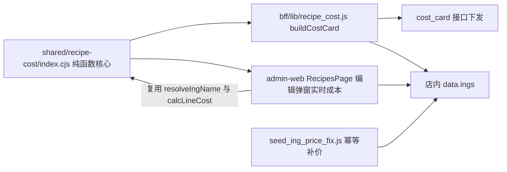

## 产品概述

治理「配方成本」两处根因：成本计算逻辑在前后端各有一份、且口径不一致，同时部分原料主数据缺失导致成本被漏算。目标是把成本计算收敛为一份前后端共享的纯函数核心，并补全缺价/缺映射原料，让后端成本卡与前端编辑弹窗「配方成本（实时）」显示一致且可信。

## 核心功能

- **统一成本计算口径**：把单位归一（斤/kg/g/规格解析）、别名归一、行成本计算抽成一份前后端共享的纯函数核心，前端编辑弹窗与后端成本卡复用同一实现，消除「克 × 元/斤」量纲错误与精确名匹配漏算。
- **别名归一回退**：成本卡在 `ing_alias` 未命中时，回退查一份共享的「品种/规格/俗称 → 实名」归一表，覆盖荸荠、冬菇、雪花粉、生抽等；不改动 W2 受控词表「tag 不进成本口径」的红线。
- **主数据补全**：给荸荠/去皮马蹄、香菇、火龙果汁、面粉补齐别名映射、正确单位，并填入常见批发估算均价且标记「待核对」。
- **验证一致性**：通过对照测试确保同一配方在前端实时预览与后端成本卡得到一致结果，红/黄饺成本不再因 missing 按 0 计而失真。

## 技术栈

- 后端：Node.js（CommonJS，零第三方依赖，无构建步骤），复用现有 `bff/lib/recipe_cost.js` 与 seed 脚本体系。
- 前端：Vite 5 + React 18 + TypeScript 5.6（ESM），复用现有 `apps/admin-web/src/pages/kitchen/RecipesPage.tsx`。
- 共享层：新建项目内共享目录 `shared/recipe-cost/`，采用单源 CommonJS 纯函数文件 + TypeScript 类型声明，前后端各自薄壳接入。
- 数据修复：复用 `ing.upsert` 写侧动作或新增幂等 seed 脚本（GET /api/db → 改 → PUT /api/db）。

## 实现方案

### 策略

把成本计算中「无副作用、无 IO」的部分（BOM 解析、单位归一、别名归一、行成本计算）从 `bff/lib/recipe_cost.js` 抽出到 `shared/recipe-cost/index.cjs`，成为唯一权威实现；后端 `buildCostCard` 与前端编辑弹窗实时成本都调用它，从根上杜绝双轨漂移。

### 关键决策

1. **共享层落地为单源 `.cjs` + `.d.ts`**：前端是 ESM/Vite、后端是 CJS/Node 且零依赖无构建，因此核心写成 CommonJS（后端直接 `require`）；前端通过一个 ESM 薄壳文件 `src/lib/recipeCostCore.ts` `import` 该 `.cjs` 并具名 re-export，配合 `.d.ts` 获得类型。算法只有一份，薄壳不含逻辑。
2. **别名归一不并入 W2 tag**：在共享核心内维护独立 `ING_ALIAS_FALLBACK` 归一表，成本卡 `resolve()` 在 `ing_alias` 未命中时回退查它；W2 受控词表继续只做检索，遵守既有红线。
3. **非纯依赖留在 `recipe_cost.js` 外层**：`isConsumable`（耗材判定）与保本价盘读取不是纯函数，保持在后端 `recipe_cost.js`，通过注入或外层分支使用，共享核心不引入 Node/IO 依赖。
4. **补价用幂等脚本并标记待核对**：新增 `bff/store-node/seed/seed_ing_price_fix.js`，走店内 `GET /api/db → 改 → PUT /api/db` 幂等补 `avg`/`unit`，并在 `ings[].spec` 追加「占位价·待核对」；脚本输出待核对清单，可重复执行、可回滚式重写。

## 实现注意

- **性能**：前端 `bomSummary` 每次表单变更都会重算，需用 `useMemo` 对 `ings` 预建「名称归一索引」与 `byName` 映射，避免逐行 `find` 全表扫；共享核心函数均为 O(1)/O(n) 的纯计算，无 IO。
- **blast radius**：`buildCostCard` 返回结构（`bom_lines`/`batch_cost`/`missing_ings` 等）保持不变，只改内部实现，避免影响 `routes/kitchen.js` 及前端 `StandardRecipeCard`；前端仅改 `calcLine` 与原料匹配，不动 UI 布局。
- **日志**：补价脚本打印「已补价条目 + 估算价 + 待核对」清单，不打印完整快照；`recipe_cost.js` 保持现有 missing 报告语义。
- **安全**：估算占位价必须显式标记「待核对」，避免被误当作真实采购均价进入经营决策；不新增任何库表，只补字段（符合「补字段优先慎建表」约定）。

## 架构设计



## 目录结构

```
canteenAI/
├── shared/
│   └── recipe-cost/
│       ├── index.cjs        # [NEW] 共享纯函数核心：parseBomLine、gramsPerUnit、stripSpec、resolveIngName（含 ING_ALIAS_FALLBACK 归一表）、calcLineCost；零依赖、无 IO，CommonJS 导出。
│       └── index.d.ts       # [NEW] TypeScript 类型声明：导出上述函数的签名与返回类型，供前端薄壳与 tsc 校验。
├── bff/
│   ├── lib/
│   │   ├── recipe_cost.js   # [MODIFY] 删除本地重复的 parseBomLine/gramsPerUnit/parseQtyText 等，改为 require 共享核心；resolve() 增加 ING_ALIAS_FALLBACK 回退；保留 isConsumable 与保本价盘非纯依赖，buildCostCard 返回结构不变。
│   │   └── recipe_cost.test.js  # [MODIFY] 更新/新增断言：红/黄饺 missing 应清空或仅剩真实未建档项，面粉计入，单位换算与别名回退正确。
│   └── store-node/seed/
│       ├── seed_recipe_links.js  # [MODIFY] MANUAL_ALIAS 补 荸荠→去皮马蹄、五得利雪花粉八星→面粉条目（与共享归一表一致）。
│       └── seed_ing_price_fix.js # [NEW] 幂等补价脚本：定位 去皮马蹄/香菇/火龙果汁/面粉 条目，补 avg 估算价、纠正香菇 unit 为斤，spec 追加「占位价·待核对」，走 GET/PUT /api/db，可重复执行。
└── apps/admin-web/src/
    ├── lib/
    │   └── recipeCostCore.ts # [NEW] ESM 薄壳：import shared/recipe-cost/index.cjs 并具名 re-export，提供前端类型入口。
    └── pages/kitchen/
        └── RecipesPage.tsx  # [MODIFY] calcLine 改为调用共享 calcLineCost（含单位归一）；ings.find 精确匹配改为 resolveIngName（含别名归一）；bomSummary 用 useMemo 建索引；onChange 选单位也用 resolveIngName。
```

## 关键代码结构

共享核心导出契约（文字描述）：

- `parseBomLine(line)`：一条 BOM 字符串 → `[{name, qty_g, raw}]`，支持括号复合行与顿号并列展开。
- `gramsPerUnit(ing)`：`1 个库存单位 = 多少克`，`斤=500`、`kg=1000`、`g=1`，并按名称内规格（`1.9L`/`1kg`/`860ml`）与 `ASSUMED_SPEC_G` 兜底，返回 `number | null`。
- `stripSpec(name)`：去掉名称尾部规格数字用于去规格匹配。
- `resolveIngName(bomName, aliasMap, byName)`：按「alias → 去括号 alias → ING_ALIAS_FALLBACK → 精确名」顺序归一，返回命中的 `ing` 或 `null`。
- `calcLineCost(qty, ing)`：`毛料 = qty / yld`，`行成本 = 毛料 / gramsPerUnit(ing) * avg`，返回 `{gross, lineCost} | null`。