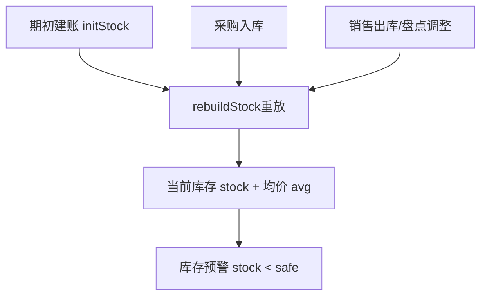

# 原料库存 模块设计

## 1. 模块职责
维护原料主数据(名称/分类/单位/换算率/安全库存/出成率)及当前库存数量与均价。库存由「期初 + 采购入库 - 销售出库 ± 盘点调整」重放得出。

## 2. 核心流程图


## 3. 数据模型 / 接口契约
- 数据结构: `DB.ings[]`
  ```
  {id, name, cat, unit, buy, conv, spec, stock, avg, initStock, initAvg, initDate, last, safe, yld, on}
  ```
- 计价: 移动加权平均法（见 `rebuildStock`）
- 关键函数: `renderIng()`、`ing(id)`

## 4. 关键设计决策 (ADRs)
- 换算率: 1采购单位 = N库存单位。当前真实采购单各品项采购单位=库存单位，conv=1
- 出成率(yld): 毛料→净料比例。当前暂无净料率数据，均设为1，待补食谱卡
- 安全库存(safe): 当前均为0，需用户在编辑中设置
- 期初库存(initStock): 真实数据基线设为0，库存由采购单重放入库

## 5. 已知限制与风险
- 原料目录当前74种，来自海南菜篮子采购单实收商品；后续新增的通道为：手工「新增原料」、「批量导入食谱卡」自动建料、「批量导入采购单」自动建料
- 出成率未设置会导致配方成本偏高（按毛料计）
- 由导入自动新建的原料：分类默认「其他」、单位默认「斤」、出成率 1、安全库存 0，需在原料行「编辑」中按实际补正

## 6. 采购单不进库存（口径澄清，2026-09-16 起 / 2026-09-21 复核）

> 库存重放的入库侧**只认进货单 `DB.recv`（实际收货）**。2026-09-16 起原 `DB.pos` 已拆分为
> 采购单 `DB.orders`（下单，**不入库**）+ 进货单 `DB.recv`（收货，入库），见 [采购管理.md](./采购管理.md) 与 [进货入库.md](./进货入库.md)。

| 项 | 采购单 `DB.orders` | 进货单 `DB.recv` |
|---|---|---|
| 是否影响 `stock`/`avg` | **否** | 是 |
| 是否调用 `rebuildStock()` | **禁止** | 必须调用 |
| 库存流水 | 无 | 有 |

- 因此本页的 `stock`/`avg` 与「采购管理」页的单据数量可能不一致，这是**预期行为**：下单 ≠ 到货。
- 「补货建议」（挂采购管理内）里的**在途量**取自未结案采购单（采购单位 × `conv` 折库存单位），
  仅用于防重复下单，**不参与库存计算**，见 [补货建议.md](./补货建议.md)。

## 7. 日均耗量反推 + 批量设置（2026-09-21 新增接线）

- `ingUseIn(gid,days)`：近 N 天 ∑（销量 × 配方净料量 ÷ 出成率），**口径与 `rebuildStock()` 的销售出库完全一致**，只读不写库存 / 均价。
- `ingDailyUse(gid,days)`：日均耗量 = 区间耗量 ÷ 天数。
- `dailyUseMap(days)`：一次遍历算完全部原料，供批量设置与补货建议共用。
- `openIngBatch()`：批量设置**安全库存 / 出成率**（出成率按百分数输入，内部夹到 0.05~1），保存后 `rebuildStock()+saveDB()+refresh()`。
- 入口：原料页工具条「⚙ 批量设置」`#btnIngBatch`（2026-09-21 修复：此前只有 DOM 与函数定义、未绑事件，点击无响应）。
- 用途：安全库存是「补货建议」缺口公式的输入之一；日均耗量决定了补货节奏。两者都在这里维护。
- 原料新增可选字段（供补货建议使用，缺失按 0 处理）：`sup` 默认供应商 / `moq` 起订量 / `pack` 整包规格（均为**采购单位**）。

## 8. 受保护逻辑
- `rebuildStock()` 移动加权平均重放逻辑，禁止直接修改
- `ingUseIn()` 的耗量口径必须与 `rebuildStock()` 的销售出库保持一致，否则补货建议与库存流水会对不上
