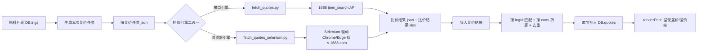

# 外接比价 模块设计

## 1. 模块职责
查询外部平台(1688/京东/淘宝/拼多多等)原料行情，与本店采购价对比，辅助采购决策。
提供两条互不干扰的通道：
- **手工通道（原有，保留）**：跳转外部平台搜索 → 人工看到价格 → 「录入报价」→ 自动换算对比
- **一键通道（新增）**：导出待比价任务 → 外部 Python 脚本批量抓价 → 导入结果 → 自动换算对比

## 2. 核心流程图

### 手工通道（原有）


### 一键通道（新增）


### 抓价引擎选择

| 引擎 | 脚本 | 适用场景 | 前提 |
|---|---|---|---|
| 接口引擎 | `fetch_quotes.py` | 有 onebound 等聚合接口 Key、追求速度 | `config.json` 填 `api_key`/`api_secret` |
| 浏览器引擎 | `fetch_quotes_selenium.py` | 开放平台接口不可用/额度不足/数据不符合预期 | 本机有 Chrome（或回落到 Edge），首次扫码登录 1688 |

两个引擎**共用同一份任务/结果 JSON 契约与写出逻辑**（浏览器引擎直接 `import fetch_quotes` 复用 `load_task`/`write_json`/`write_excel`），产出的 `比价结果.json` 对前端完全等价。

浏览器引擎关键设计：
- 持久化 Chrome 用户目录 `比价脚本/chrome_profile/`，首次扫码登录后长期免登录
- 反自动化指纹：`--disable-blink-features=AutomationControlled` + CDP 覆写 `navigator.webdriver`
- **节奏控制**：每次浏览器操作间 `sleep ~2.5s`（`delay` 可调、`jitter` 抖动），避免触发风控
- 商品卡片选择器多套兜底（1688 前端改版频繁），命中的选择器会打印出来便于排查
- 遇到登录/滑块验证 → 暂停提示人工处理并轮询等待（`login_wait` 秒），超时存现场截图到 `比价脚本/debug/`
- 每 10 个原料落一次中间结果，避免中途中断白跑

### 询价清单（清单询价）转换

`比价脚本/make_quote_list.py` 把 `待比价任务.json` 转成 1688「清单询价」可上传的 Excel：按类目拆 sheet、"采购数量"列留空待填、内置数据校验与使用说明页；同时产出 Markdown 说明文档。输出到项目根目录 `询价清单/`。它不抓价、不产生 `DB.quotes` 数据，仅作人工询价的辅助材料。

## 3. 数据模型 / 接口契约
- 数据结构:
  - `DB.quotes[]`: `{id, ing, src, price, per, date, note}`
  - `DB.platforms[]`: `{name, tpl}` — 比价平台URL模板，`{kw}` 为关键词占位
- 报价换算: 外部价按采购单位(per='buy')录入，换算为库存单位 = price / conv
- 关键函数: `renderPrice()`、`quotePerStock()`、`bestQuote()`、`openQuote()`、`openQuoteList()`

### 一键通道的文件契约（前后端严格对齐，改字段须同步改三处）

**待比价任务.json**（前端 `exportQuoteTask()` 产出）
```json
{
  "type": "panda-quote-task", "version": 1,
  "rest": "熊猫五福餐厅", "generatedAt": "2026-09-13T10:00:00.000Z", "guide": "…",
  "items": [{"ingId":"I1","ingName":"东古一品鲜500ml","cat":"干调类","unit":"瓶",
             "buy":"瓶","conv":1,"avg":8.1,"keyword":"东古一品鲜","taskDate":"2026-09-13"}]
}
```

**比价结果.json**（脚本产出，前端 `importQuoteResult()` 消费）
```json
{
  "type": "panda-quote-result", "version": 1,
  "generatedAt": "2026-09-13T11:00:00", "rest": "熊猫五福餐厅", "source": "1688(API)",
  "stats": {"total":74,"ok":60,"empty":12,"skip":2},
  "items": [{"ingId":"I1","ingName":"东古一品鲜500ml","keyword":"东古一品鲜",
             "source":"1688(API)","price":7.45,"per":"buy","unitPrice":7.45,
             "minQty":1,"shop":"某商行","location":"广州","url":"https://…",
             "date":"2026-09-13","title":"商品标题","note":"规格核对:…"}]
}
```
- `price` 口径 = **1 个采购单位(buy)** 的价格，与该原料 `conv` 一致；`per` 固定 `'buy'`
- 两个抓价引擎产出的 `比价结果.json` 结构完全一致，前端无需区分来源；差异只体现在 `source` 标签（`1688(API)` / `1688(网页)`）与 `stats.engine`
- 导入时按 `price / conv` 折算为库存单位成本 → 与手工录入路径完全同构
- 导入为**追加**语义，按「`ing` + `src` + `price`」去重；不删除/覆盖既有报价
- `ingId` 必须在 `DB.ings` 中命中，否则计入「原料未匹配」并跳过
- 脚本额外产出 `比价结果.xlsx`（人看，含折算库存单价/差价/差价率，全部为 Excel 公式）

## 4. 关键设计决策 (ADRs)
- 当前 Q_SEED 为空（暂无真实外部报价）
- **手工比价保留**：`openQuote()` / `pricePop()` / `renderPrice()` / `openQuoteList()` 逻辑本次零改动
- **一键比价落地**（原「脚本文本.txt 中的1688 API方案为可选扩展」已实现）：采用「导出任务 → 脚本抓取 → 导入回填」的三段式离线流水线，前端不发起跨域请求、不持有 API 密钥
  - 复用 `DB.quotes` 单一数据模型，脚本结果映射为与手工录入相同的结构，故 `renderPrice()` 等渲染函数零改动生效
  - 任务清单携带 `conv` / `avg` 快照，脚本无需理解业务换算规则；前端导入时再做一次权威折算
  - 关键词自动净化（去规格/容量后缀）+ `config.json` 可配全局后缀，提升 1688 命中率
  - 换算率 ≠ 1 的原料脚本默认跳过（1688 报价口径难以自动对齐），可在 `config.json` 设 `allow_conv_grab: true` 强制抓取后人工核对
- **抓价引擎可替换**（2026-09-13 追加）：开放平台接口（onebound）数据不符合预期时，改用 `fetch_quotes_selenium.py` 以真实浏览器抓取 `s.1688.com` 搜索结果。两个引擎共用任务/结果契约，前端与 `DB.quotes` 结构零改动
- 浏览器引擎必须**人工首登**一次（扫码），登录态存于 `比价脚本/chrome_profile/`；该目录含个人登录凭据，**禁止外发/提交仓库**
- 浏览器引擎节奏默认 2.5s/次操作，**禁止为提速把它调到 1s 以下**（会触发风控，反而拿不到数据）
- 默认平台: 1688批发/京东/淘宝/拼多多/百度爱采购/美菜商城/美团快驴（1688 项支持脚本自动抓价，其余为跳转搜索）

## 5. 已知限制与风险
- 外部报价仍需人工判断是否可信：1688 报价常**不含运费/不含税/规格不一致**，导入前请核对 Excel 的「商品标题/规格核对」列
- 单位换算依赖原料 conv 字段，需保证准确；conv ≠ 1 的原料默认不自动抓取
- 接口引擎依赖第三方聚合接口（onebound 等）的 API Key，无 Key 时脚本会明确报错并提示申请方式（`--dry-run` 可免密钥验证流程）
- 浏览器引擎的 DOM 选择器依赖 `s.1688.com` 当前结构，**1688 改版可能导致抓取为空**；脚本用多套选择器兜底并在日志里打印命中的选择器，失效时按日志更新 `CARD_SEL`/`TITLE_SEL`/`PRICE_SEL` 即可
- 浏览器引擎比接口慢（约 2.5s/操作 × 下滑次数），74 种原料全量抓取耗时较长；建议先用 `--limit 3` 试跑确认选择器有效
- 导入为追加语义，重复运行脚本且价格波动时会产生多条报价（同价格重复项自动跳过）；如需清理可在「报价记录」里逐条删除
- 多次导入不构成库存/成本污染：`DB.quotes` 只参与比价展示，不参与 `rebuildStock()` / `dishRecipeCost()`

## 6. 受保护逻辑
- `rebuildStock()`、`dishRecipeCost()`、`calcSaleCost()`、`seedDB()`、`LS_KEY` 均未被本次改动触碰
- 一键比价只写 `DB.quotes`，禁止写入 `DB.logs` / `DB.ings.stock` / `DB.ings.avg` / `DB.rec`

## 7. 相关文件
- 前端: `熊猫五福餐厅进销存系统_真实数据版.html` → `#tab-price` 面板 + JS「外接比价」区块（`exportQuoteTask` / `importQuoteResult` / `quoteTaskText` / `quoteKeyword` / `openQuotePlan` / `renderPriceTaskTip`）
- 脚本:
  - 接口引擎: `比价脚本/fetch_quotes.py` + `比价脚本/运行比价.bat`
  - 浏览器引擎: `比价脚本/fetch_quotes_selenium.py` + `比价脚本/运行比价-网页版.bat`（产出 `比价脚本/chrome_profile/`、`比价脚本/debug/` 运行时目录）
  - 询价清单转换: `比价脚本/make_quote_list.py`（产出项目根目录 `询价清单/`）
  - 公共: `比价脚本/config.json`、`比价脚本/requirements.txt`、`比价脚本/生成任务说明.md`
