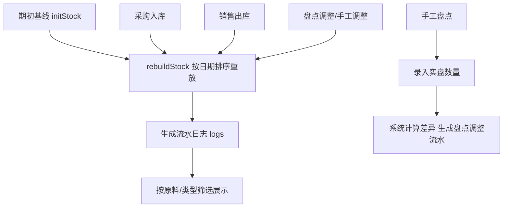

# 库存流水 模块设计

## 1. 模块职责
展示所有库存变动流水(期初/采购入库/销售出库/盘点调整/手工调整)，支持按原料/类型筛选。提供盘点调整功能，记录盈亏。

## 2. 核心流程图


## 3. 数据模型 / 接口契约
- 数据结构: `DB.logs[]`
  ```
  {seq, t, date, type, ing, qty, inCost, cost, bal, ref}
  ```
  - type: 期初/采购入库/销售出库/盘点调整/手工调整
  - qty: 变动数量(正入库/负出库)
  - bal: 变动后结余
- 重放顺序: 期初(o=0) → 手工调整(o=1) → 采购入库(o=2) → 盘点调整(o=3) → 销售出库(o=4)，同日期按 o 排序
- 关键函数: `rebuildStock()`、`mkAdjLog()`、`renderStock()`

## 4. 关键设计决策 (ADRs)
- 流水由 `rebuildStock()` 自动重放生成，不手工编辑 logs
- 盘点调整: 录入实盘数，系统自动生成差异流水，调整库存但不改变均价
- 手工调整: 直接设置库存和均价（用于建账纠错）

## 5. 已知限制与风险
- `rebuildStock()` 是计价核心，任何修改必须输出 [EDIT_PLAN]
- 流水日期相同时按类型优先级排序，可能与实际操作时间有偏差

## 6. 受保护逻辑
- `rebuildStock()` 移动加权平均重放逻辑，禁止直接修改
- `mkAdjLog()` 流水生成逻辑
