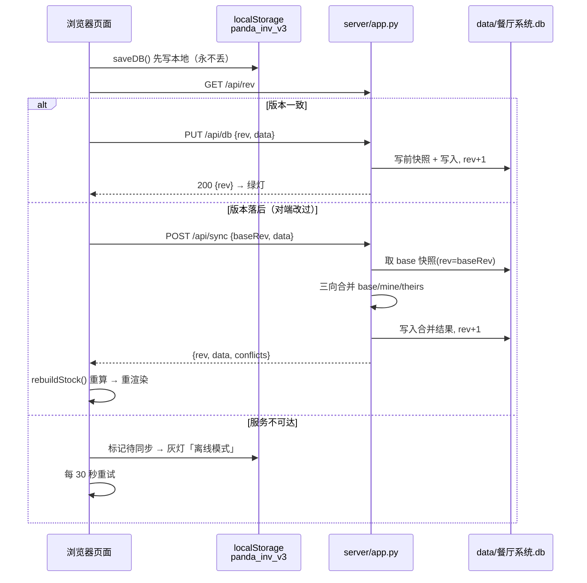

# 数据同步与备份 架构设计

## 1. 模块职责

解决"数据只活在浏览器里"的问题：把进销存全量数据落到本机文件 `data/餐厅系统.db`（SQLite），
并保留浏览器 localStorage 作为**离线兜底**，使系统在下列场景都不丢数据：

- 清浏览器缓存 / 换浏览器 / 无痕模式
- 把 HTML 发给别人（对方不再看到空白旧数据）
- 店与家两台电脑切换使用（自动合并两端改动）
- 服务没启动（页面照常用，改动暂存浏览器，下次补传）

**边界**：本模块只负责"搬运与合并"整库 JSON，不解释任何业务字段；
落地后强制调用 `rebuildStock()` 重算库存与均价，不采信任一端传来的派生值。

## 2. 核心流程图



## 3. 数据模型 / 接口契约

### 3.1 数据库（SQLite）

```sql
CREATE TABLE docs(
  id INTEGER PRIMARY KEY CHECK(id=1),  -- 只有一行：整库
  data TEXT,        -- DB 对象序列化后的 JSON
  rev INTEGER,      -- 单调递增版本号，乐观锁
  updated_at TEXT, machine TEXT, app TEXT
);
CREATE TABLE snapshots(                -- 每次写入前后各留一版
  id INTEGER PRIMARY KEY AUTOINCREMENT,
  rev INTEGER, data TEXT, ts TEXT, machine TEXT, note TEXT
);
```

不拆表：DB 原本就是一个可序列化的 JS 对象，整库存取 = 业务代码零改动，
合并统一在 JSON 层做，避免为每个集合写 ORM 映射。

### 3.2 HTTP 接口（`server/app.py`）

| 方法 | 路径 | 入参 | 说明 |
|---|---|---|---|
| GET | `/api/health` | - | 服务与库状态（含各集合条数） |
| GET | `/api/rev` | - | 只取版本号，判断是否需要合并 |
| GET | `/api/db` | - | 取整库 `{rev, data}` |
| PUT | `/api/db` | `{rev, data, machine, force?}` | 整库写；rev 不匹配返回 409；`force` 强制覆盖 |
| POST | `/api/sync` | `{baseRev, data, machine}` | 三向合并后写入 |
| GET | `/api/snapshots` | - | 快照列表（设置页展示） |
| POST | `/api/snapshot` | `{machine, note}` | 手动打快照 |
| POST | `/api/rollback` | `{rev, machine}` | 回滚到指定快照 |
| GET | `/` | - | 静态首页（可选访问方式） |

命令行：`python server\app.py --port 8765 --host 127.0.0.1 --db data\餐厅系统.db --machine SHOP`

### 3.3 前端函数（`熊猫五福餐厅进销存系统_真实数据版.html` 持久化段落）

| 函数 | 职责 |
|---|---|
| `saveDB()` | 打戳 → 写 localStorage → 800ms 防抖后触发同步（签名不变） |
| `loadDB()` | 仅读 localStorage（启动时兜底） |
| `isFreshClient()` | 判定本机是否从未有过数据（无 `LS_KEY` 且无 `REV_KEY`） |
| `stampDB()` | 记录内容变化时写入 `_u`（更新时间），供合并比较 |
| `pushNow()` | 同步主流程：取 rev → 直写 / 合并 / 离线降级 |
| `startSync()` | 启动握手，三条分支：<br/>① 空库 → `initStamps()` 后 `pushNow()` 灌入本机数据（迁移）<br/>② **全新客户端**（`isFreshClient()` 为真）→ 直接 `applyRemote()` 以数据库为准落地，不 push<br/>③ 常规 → `pushNow()` |
| `applyRemote(data)` | 采用数据库数据 → 落地后 `rebuildStock()` + `refresh()` |
| `setLamp()/renderSyncInfo()/renderSnapTable()` | 状态灯、设置页信息、快照表 |

### 3.4 合并规则（`server/merge.py`）

按记录唯一键逐条三向比较：`ings/dishes/pos/sales/quotes` 用 `id`，`logs` 用 `seq`，
`rec` 按菜品 id 比较 `_recU`，`suppliers` 取并集，`platforms` 按 `name`。

| 情况 | 结果 |
|---|---|
| 只有一端改 | 用改过的那端 |
| 两端都改 | 比 `_u`，新的胜；相同取数据库版本并记冲突 |
| 一端删、另一端未改 | 删除生效 |
| 一端删、另一端改过 | 保留改过的那条并记冲突 |
| 两端各自新增 | 都保留 |

## 4. 关键设计决策 (ADRs)

- **决策1 整库 blob 而非拆表**: DB 本就是单个 JSON 对象，整库存取使 8 个 tab 业务代码零改动；拆表要写双向映射，风险与工作量都高一个量级。合并精度靠 JSON 层记录级 diff 保证，不依赖表结构。
- **决策2 保留 localStorage 而非替换**: 用户习惯双击 HTML 使用，且"服务忘了开"是常态。双写 + 离线队列保证任何情况下录入都不丢，服务可用时补传。
- **决策3 合并放在服务端**: 合并需要 base 快照（存于库内），前端只传 `baseRev`；避免前端下载两份全量数据，也保证只有一份合并实现（`server/merge.py`），`合并副本.bat` 可复用。
- **决策4 CORS 全放行**: 页面多从 `file://` 打开，origin 为 `null`；服务端返回 `Access-Control-Allow-Origin: *` 使其能直连本地服务（仅监听 127.0.0.1，不对外暴露）。
- **决策5 派生值强制重算**: `stock/avg` 由 `rebuildStock()` 从单据重放得出，同步后一律重算，避免把对端的中间态当作权威值，保护移动加权平均计价核心。
- **决策6 不用 WAL**: 数据库可能放网盘同步目录，WAL 的 `-wal`/`-shm` 文件易丢失导致库损坏，故用默认 journal 模式。
- **决策7 全新客户端一律以数据库为准**: 换电脑/换浏览器/清缓存后，本机既无 `LS_KEY` 也无 `REV_KEY`，此时 `loadDB()` 失败会触发 `seedDB()` 生成示例数据；若照常 `pushNow()`，服务端因 `baseRev=0` 走 `first-merge` 分支 `merge({}, 种子数据, 库数据)` 得到**并集**，示例原料/菜品会被写进真实库（id 不同 → 大量重复记录）。故 `startSync()` 增设 `isFreshClient()` 分支：直接 `applyRemote(doc.data)` 落地后同步 rev，**不发起任何写入**。
  - 反面教材：**不可**通过"预置 `panda_rev_v1` = 服务端 rev"来规避——那样会命中 `PUT /api/db` 分支，用种子数据**整体覆盖**真实库，比重复更严重。

## 5. 已知限制与风险

1. **`uid()` 仍是单机自增**（`p + DB.seq++`）：两台机器可能生成相同 id。当前靠"两端各自新增 → 内容不同则记冲突并保留两条"兜底。正式启用"两台机器同时大量录入"前，需改为 `p+机器码+seq+随机`，老数据 id 保持不变。
2. **同一时刻只建议一台机器录入**：网盘是文件级同步，若两端服务同时写同一 db，可能产生冲突副本（可用快照回滚 + 手工合并找回）。
3. **快照数量**：库内保留最新 200 版，冷备份保留 30 天。base 快照若被挤出，客户端会走 `need-manual`（保命存本机版本 + 采用数据库版本）而非盲合并。
4. **删除未做墓碑**：目前靠"三向都在/缺失"判断删除语义；一端删除另一端修改时会保留修改并记冲突，不会误删，但删除不会跨端强制生效到历史版本。
5. **服务未启动时的可见性**：依赖顶栏状态灯提示，用户若不注意可能在离线模式下长期录入（数据仍在浏览器，不会丢，只是未入库）。
6. **localStorage 按 origin 隔离**：`http://127.0.0.1:8765/` 与 `file://` 双击打开是两套互不相通的 localStorage（后者 origin 为 `null`）。同一台机器建议固定一种访问方式，否则会出现"两处数据看起来不一致"。跨源搬运数据只能走设置页的 JSON 导出/导入。
7. **新机器首次握手依赖 `isFreshClient()` 判定**：若用户手工把 `panda_rev_v1` 设成了某个值（非 0），判定会失效而退回常规 `pushNow()` 流程，退化到第 5 节之前的行为。清缓存/换机器时请勿手工改写这两个 key。
8. **同步集合未随「采购进货」拆分更新**：前端 `SYNC_COLL` 与服务端 `merge.py` 的 `COLL_KEY` 仍是旧的 `['ings','dishes','pos','sales','quotes','logs']`，**不含 `recv`/`orders`/`plans`/`restock`/`dishAlias`**。迁移后 `DB.pos` 已被删除（仅留空集合），而实际业务数据落在 `DB.recv`/`DB.orders` 等；后果：本机新增的进货单/采购单/补货建议在**服务端合并时会被 `theirs` 整表覆盖**（`merge()` 首行 `out.update(theirs)`），且因这些集合没有 `_u` 时间戳而无法走记录级合并。修复（尚未实施，需 [EDIT_PLAN] 确认）：两处都改为 `recv`/`orders`/`plans`/`restock`/`dishAlias` 并补 `_u` 时间戳。在此之前双机同时录单请以导出/导入 JSON 备份为准。详见 [采购管理.md](./采购管理.md) 第 5 节、[补货建议.md](./补货建议.md) 第 5 节、[进货入库.md](./进货入库.md) 第 7 节。

## 6. 受保护逻辑

- `rebuildStock()` 移动加权平均重放（计价核心）—— 同步层只能调用，禁止改写
- `dishRecipeCost()` / `calcSaleCost()` 成本核算 —— 同上
- `seedDB()` 真实数据基线 —— 禁止因同步/合并而重新播种覆盖真实数据
- `server/merge.py` 的合并规则 —— 修改需同步更新本文档与 CHANGELOG
