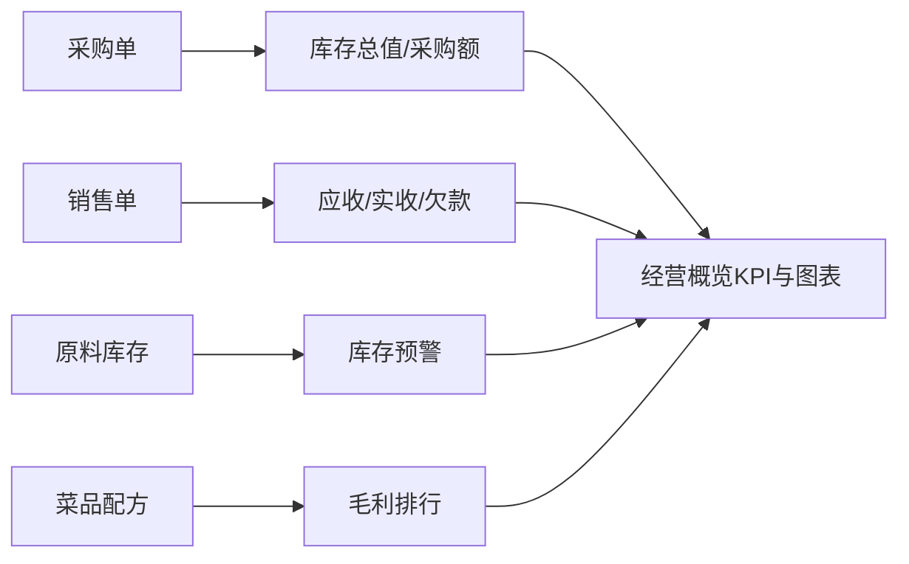

# 经营概览 模块设计

## 1. 模块职责
汇总展示餐厅经营核心指标：应收/实收/欠款、采购额、库存总值、菜品毛利排行、库存预警。**只读模块，不产生数据写入。**

## 2. 核心流程图

## 3. 数据模型 / 接口契约
- 输入: `DB.recv`(进货单，提供「采购应付」KPI)、`DB.sales`(销售单)、`DB.ings`(原料，提供库存总值/预警)、`DB.dishes`(菜品，提供毛利排行)
  - 说明：2026-09-16 起原 `DB.pos` 已拆为 `DB.recv`(实际收货，计入应付与库存) 与 `DB.orders`(采购订单，只记录往来、**不计入**本页应付)。本页「采购应付（本期）」取自 `DB.recv` 的 `payable`，见 [原料库存.md](./原料库存.md) 第 6 节口径澄清。
- 输出: DOM 渲染 KPI 卡片 + 每日应收/实收柱状图 + 库存预警列表 + 未收账款列表 + 菜品毛利排行表
- 关键函数: `renderDash()`

## 4. 关键设计决策 (ADRs)
- 统计周期切换(近7天/近30天/全部): 纯前端过滤，不持久化
- 菜品毛利排行基于近30天实际销售单，无销售单时为空

## 5. 已知限制与风险
- 无销售单时销售类KPI显示0，属正常状态
- 图表为纯 SVG 绘制，无第三方图表库依赖

## 6. 受保护逻辑
无
