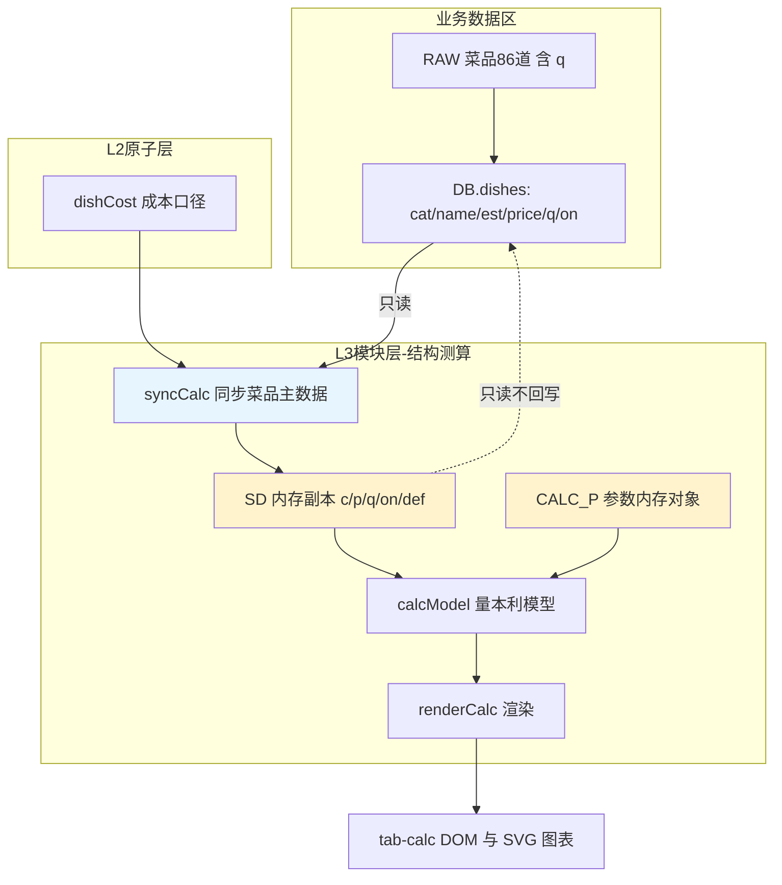

# 结构测算 模块设计

## 1. 模块职责
将「熊猫五福餐厅菜品保本测算」的量本利（CVP）模型内嵌进销存系统，提供菜品结构分析与保本点测算能力。

**核心定位：只读测算层。** 本模块只消费菜品主数据，不产生任何业务数据写入，以此实现「菜品配方管理」与「毛利测算」的彻底隔离。

## 2. 核心流程图


## 3. 数据模型 / 接口契约

### 3.1 内存副本 SD（不落库）
```javascript
SD[i] = {
  id,                   // 关联 DB.dishes[i].id
  n: name,              // 菜名
  t: cat,               // 类型（引流/爆品/利润/形象/常规）
  c: dishCost(d),       // 成本：已配配方取配方实时成本，未配取 est
  p: +d.price,          // 售价
  q: calcQtyOf(d),      // 日销量（仅本页使用，按 SC_QMODE 口径取值）
  est: +d.q,            // 只读元信息：菜品主数据估算值（兜底用）
  sq: 近N天总销量,       // 只读元信息：真实口径下的销售总份数（估算口径为 0）
  src: 'real'|'est',    // 只读元信息：本行日销量的来源
  on: true,             // 是否上架（模拟）
  def: {c,p,q,on}       // 初始快照，供「重置」使用
}
```

### 3.2 运行态参数 CALC_P（不落库）
由三组基线的 key/default 构成，恢复默认时重置为基线值：
- `P_FIX`（固定成本 11 项）：`area/rentPsm/propFee/staff/laborPer/fit/fitM/eq/eqM/utilFix/other`
- `P_VAR`（变动成本率 9 项，小数存储）：`bevRatio/bevCost/pack/takeout/comm/mkt/utilVar/misc/fee`
- `P_OP`（运营口径 4 项）：`dishPerGuest/days/seats/targetProfit`

### 3.3 计算结果 CR
`calcModel()` 产出的量本利全量结果，供各渲染子函数消费：
`act/revDish/costDish/qty/crDish/crAll/varRate/cm/rent/prop/labor/amort/fc/beDay/guests/avgDish/avgAll/revAllDay/monthRev/monthProfit/beGuests/safety/varOtherM` 等。

### 3.4 关键函数
| 函数 | 职责 |
|------|------|
| `syncCalc()` | `DB.dishes` → `SD` 重建（含 def 快照），成本取 `dishCost(d)`、日销量取 `calcQtyOf(d)` |
| `dishRealQty(did,daysN)` | 近 N 天销售总份数（`s.date >= daysAgo(N-1)`，与配方页 `dishSalesAgg` 同源） |
| `calcQtyOf(d)` | 日销量取值：估算口径取 `d.q`；真实口径取 `dishRealQty/N`，为 0 时按 `SC_QFALLBACK` 回落 `d.q`（关闭则 0） |
| `calcStatText()` | 底部口径文案（成本口径 + 日销量口径 + 真实/回落道数 + 不写回声明） |
| `buildCalcParams()` | 首次构建参数输入区（幂等，`el.dataset.built==='1'` 时跳过） |
| `calcModel()` | 量本利计算引擎，产出 `CR` |
| `renderCalc()` | 进入 calc tab 的统一入口（`refresh()` 调度） |
| `calcTypeStats(list)` | 五类角色汇总（日销量/日营收/日毛利/成本率） |
| `renderCalcKpi/Params/Types/Table/Charts/Scene/Advice()` | 各区块渲染 |
| `calcSortedIdx()` | 排序 + 类型筛选索引 |
| `updateCalcRow(i)` / `updateCalcGroups()` | 单行/分组行局部更新（避免整表重绘） |

## 4. 关键设计决策 (ADRs)

### ADR-1 只读隔离（最高优先级约束）
测算页所有操作（调价、调量、上下架、批量调整、行内重置）**只修改内存数组 `SD`**。
- **禁止**调用 `saveDB()`
- **禁止**写 `DB.rec`（配方）、`DB.dishes`、`DB.ings`、`DB.recv`、`DB.orders`、`DB.sales`
- 页面刷新 / 重新进入 tab / 点「同步菜品主数据」即从 `DB.dishes` 复位

**理由**：用户明确要求「菜品配方的管理应与毛利测算功能做隔离处理」。测算页是"沙盘推演"，配方页是"生产数据"，二者混写会导致配方被模拟调价污染。

### ADR-2 成本口径取 `dishCost(d)`
初始成本不使用 `est` 硬值，而取 `dishCost(d)`：
- 已配配方的菜 → 配方实时成本（Σ 净料用量÷出成率×库存均价）
- 未配配方的菜 → 回退 `est`

**理由**：与「菜品配方」页口径完全一致，保证两页成本可比；配方更新后点「同步菜品主数据」即可刷新测算口径。

### ADR-3 参数不落库
`CALC_P` 仅存在于内存，不写入 `DB`。

**理由**：避免扩展 `DB` 字段结构（架构文档定义的契约），降低回归风险；参数属于"分析假设"，不是经营数据。

### ADR-4 算法原样移植
保本测算源文件的公式体系逐条平移：
`crAll=(1-bevRatio)*crDish+bevRatio*bevCost` → `varRate` → `cm` → `fc` → `beDay=fc/cm/days` → `guests` → `avgAll` → `monthProfit` → `safety`。

**理由**：保证测算结果与原独立工具数值一致、可交叉验证。

### ADR-5 惰性渲染
`refresh()` 仅在 `TAB==='calc'` 时调用 `renderCalc()`，符合既有按 tab 懒渲染模式。

**理由**：避免每次切 tab 都重算 86 道菜的量本利模型。

### ADR-6 命名前缀隔离
新增全局标识符使用 `CT`/`CT_COLOR`/`SC_`/`CALC_`/`SD`/`CR` 前缀；事件委托选择器以 `#tab-calc` 或 `data-sc-*` 限定作用域。

**理由**：主文件已占用 `D`/`P`/`R`/`TYPES`/`TC`/`data-bulk`/`#tbody`/`#tabs` 等，避免冲突与事件重复绑定。

### ADR-7 日销量口径可切换（2026-09-21 新增）
结构测算页新增「日销量口径」下拉 `#scQMode` + 兜底勾选 `#scQFb`：

| 口径 | 取值 |
|---|---|
| 估算 q（`est`） | 直接用 `DB.dishes.q`（基线假设值，行为同 v1.2.0） |
| 近30天真实（`real30`，**默认**） | `dishRealQty(did,30) / 30` |
| 近7天真实（`real7`） | `dishRealQty(did,7) / 7` |

- **除以 N 是模型要求**：量本利模型的 `q` 是**日均**销量（用于算日营收/日毛利），若直接填近 N 天总销量会把日营收放大 N 倍。
  与菜品配方页「近 N 天销量」（总份数）**同源同口径**，只是展示维度不同。
- **兜底默认开启**：真实口径下近 N 天无销量（新菜/季节性菜/超窗口）→ 自动回落 `d.q`；取消勾选则按 0 计（该菜不计入营收）。
- **只读隔离不变**：`calcQtyOf()` 只返回值，**绝不写回 `DB.dishes.q`**（回归断言已固定 `DB.dishes.q` 前后不变）；
  `SD[i].def.q` 存的是当前口径值，行内「重置」不会跳变。
- 口径切换会重建 `SD`（等同「同步菜品主数据」），会丢弃本页手工调量；这是预期行为，切换即取新口径。
- 销售导入 / 整批撤回后，若 `CALC_READY && SC_QMODE!=='est'` 会自动 `syncCalc()` 刷新。

**理由**：`q` 是当初为测算造的假设值，接入真实销售数据后应让量本利模型跑在真实销量上，否则保本点/结构分析无参考价值。

## 5. 已知限制与风险
- 未配配方菜品成本基于 `est` 估算值，测算结果精度受限于估算准确性
- 量本利为线性模型假设：固定成本不随客流变化；实际客流超过保本线 1.5 倍后需增派人手、加大营销，净利率会回落，建议以 10%-15% 作保守预期
- `q`（日销量）为基线假设值，不代表真实经营销量；切到「近30天/近7天真实」口径后即为真实日均（无销量时仍回落估算值），真实销量请参考「经营概览」基于 `DB.sales` 的毛利排行
- 真实口径的**日均**是「区间总销量 ÷ 自然日数」，未剔除休市/停业日；若某段时间未营业，日均会被摊薄（可切近7天口径对比）
- 参数与模拟调整均不持久化，关闭页面即丢失（设计如此）

## 6. 受保护逻辑
无写入逻辑，故无数据侧风险。以下为只读依赖，禁止修改其行为：
- `dishCost(d)`（L2 原子层，配方成本口径）
- `DB.dishes` 的 `q` 字段（仅种子数据可写）
