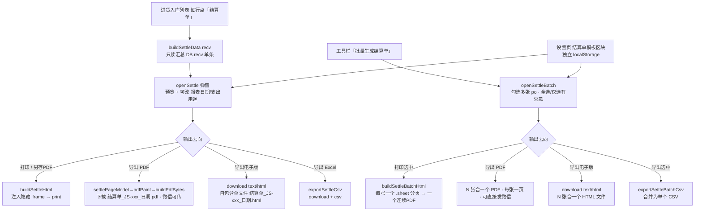

# 结算单（进货付款审批单） 模块设计

## 1. 模块职责

把「进货入库」模块的**单张进货单**转成一张**内部付款审批单**，供老板/财务审批后向供应商付款。输出为 **PDF（可在微信直接传阅）**、电子版 HTML（自包含单文件）、A4 打印版式与 Excel(CSV)。本模块是**只读输出层**：不产生任何业务数据写入，不改变库存、均价、应付口径。

> 入口挂在「进货入库」页的进货单行内「结算单」按钮（数据源 `DB.recv`）。采购下单请见 [采购管理.md](./采购管理.md)；收货入库请见 [进货入库.md](./进货入库.md)。

## 2. 核心流程图



## 3. 数据模型 / 接口契约

- **输入（只读）**: `DB.recv[]` 单条记录（进货单，单号 `JH-`）
  ```
  {id, no, date, supplier, lines:[{ing,qty,price,conv,amount,unitCost}], payable, payments:[], note, method, po?}
  ```
- **模板配置（独立 localStorage key）**: `panda_settle_tpl_v1`（**不占用 DB、不影响 LS_KEY 版本**）
  ```
  {title, restName, addr, tel, taxNo, usePurpose,
   payeeName, payeeBank, payeeAccount,
   subjects:['经办人','审核人','审批人'], footer}
  ```
- **关键函数**:
  - `loadSettleTpl()` / `saveSettleTpl(t)` — 模板读写，缺字段自动补默认值
  - `numToCn(money)` — 阿拉伯数字 → 人民币大写（支持到亿，含角分，如 4480 → 肆仟肆佰捌拾元整）
  - `buildSettleData(recv)` — 只读汇总：明细行 / 项数 / 合计数量 / 应付全额 `payable` / 已付 `recvPaid()` / 欠款 `recvDebt()`
  - `SETTLE_CSS` — 结算单样式常量（含 `.sheet{page-break-after:always}` 分页规则），单张与批量共用
  - `settleSheet(po, tpl, opts, extra)` — **单张正文**（不含 `<html>/<style>`）；`extra={index,total}` 时页脚标注「第 n/N 张」
  - `settleDocHtml(sheets, title)` — 把若干 `.sheet` 包成完整文档（注入 `SETTLE_CSS`）
  - `buildSettleHtml(po, tpl, opts)` — 单张完整文档 = `settleDocHtml` + 单个 `.sheet`
  - `buildSettleBatchHtml(list, tpl, opts)` — **批量**：N 张进货单 → N 个 `.sheet` 的单个文档
  - **PDF 导出（零依赖）**：`settlePageModel` 纯计算页面指令 → `pdfPaint` Canvas 绘制 → `pdfCanvasJpeg` 取 JPEG → `buildPdfBytes` 组装 PDF（DCTDecode 图像 XObject + xref）；入口 `settlePdfBlob` / `exportSettlePdfList`
- **电子版 HTML 导出**（弹窗按钮「导出电子版(HTML)」/「导出选中 · 电子版」）：直接 `download(name, buildSettleHtml/buildSettleBatchHtml(...), 'text/html')`
  - 单张文件名 `结算单_JS-单号_报表日期.html`；批量 `结算单_批量_报表日期_N张.html`
  - 文件即打印文档本身（含 `SETTLE_CSS`），自包含、无外部依赖，任何浏览器可打开，适合微信发送留档，打开后 `Ctrl+P` 仍可再转 PDF
- `printHtmlDoc(html)` — 通用打印：注入隐藏 iframe 并调用 `print()`（规避弹窗拦截）
  - `printSettle(po, opts)` / `printSettleBatch(list, opts)` — 单张 / 批量打印（批量=一个连续 PDF）
  - `exportSettleCsv(po, opts)` — 导出单张结算单 CSV（UTF-8 BOM，Excel 直接打开）
  - `exportSettleBatchCsv(list, opts)` — 批量导出：合并为一个 CSV，含批量汇总行与每张明细
  - `openSettle(po)` — 单张生成弹窗（报表日期、支出用途可改，不落库）
  - `openSettleBatch()` — 批量生成弹窗（行勾选 + 全选/全不选/仅选有欠款 + 实时合计）
  - `renderSettleTplForm()` — 设置页模板表单回填
- **金额口径**（用户确认）: 抬头「小写合计 / 人民币大写」均取 **应付全额 `payable`**；同时附列 已付 / 欠款 供参考
- **单据编号**: `JS-` + 收货单号（如 `JS-JH20260912-01`）

## 4. 关键设计决策 (ADRs)

- **1 张进货单 → 1 张结算单**（用户确认）：单据粒度仍是 1:1，**不按供应商/区间合并成一张**；批量入口只做「多张单子一次性生成」，不改变单据定义
- **批量 = 多份单据打包输出，而非合并成一张**：`buildSettleBatchHtml` 生成 N 个 `.sheet`（`page-break-after:always`），一次打印拿到一个连续 PDF；每张页脚标注「第 n/N 张」便于核对。批量「导出」同理是**一个 CSV 里顺序存放 N 张单**
- **重构抽出 `settleSheet` / `settleDocHtml` / `SETTLE_CSS`**：单张与批量共用同一版式与样式，避免 CSS 复制两份导致后续维护漂移；`buildSettleHtml` 的输出契约保持不变（仍是完整文档）
- **模板存独立 localStorage**（用户确认）：避免改动 `DB` 结构与 `LS_KEY` 版本，零迁移风险；恢复默认仅重置模板，不动业务数据
- **PDF 自造字节流、不引 CDN 库**：本地单文件须离线可用；PDF 标准字体不含中文、嵌入 CJK 字体又过大，故用「Canvas 光栅化 + 极简 PDF 容器」，零依赖且中文必然正确
- **打印用隐藏 iframe 而非 `window.open`**：规避浏览器弹窗拦截，且不打断当前页面状态；结算单样式全部内联在 iframe 文档内，主页面**不新增任何 `@media print`**，避免影响主站打印
- **模板要素对齐财务支出报表**：报销/报表日期、支出用途、数量、单价、小写合计、人民币大写、三签字栏（经办人/审核人/审批人）
- **明细逐条列原料**（用户确认）：明细表按 `po.lines` 逐行展开

## 5. 已知限制与风险

- 无 XLSX 库，Excel 版为 CSV（UTF-8 BOM），需在 Excel 中另存为 `.xlsx`
- 批量「合并 CSV」是**同一个文件里顺序堆叠 N 张单**，不是 Excel 多 Sheet 多工作簿（导出后可按需拆分）
- 批量打印张数很多时，一次生成的 PDF 会很长，浏览器渲染可能需要等待
- 「支出用途 / 报表日期」仅在生成时生效，不落库（模板里可设默认「支出用途」）
- 打印依赖浏览器打印对话框，需用户手动选「另存为 PDF」；移动端微信内可能不支持打印，建议**导出电子版 HTML**（接收方直接打开）或 CSV/截图
- PDF 每页为 **JPEG 位图**（约 200dpi），文字不可选中/搜索；一页约 230~400KB，手机微信阅读清晰，放大后为像素级
- PDF 绘制是 `settleSheet` 版式的**镜像实现**（手工坐标），改动 HTML 版式时必须同步 `settlePageModel`，否则电子版与打印版会漂移
- 明细行超过一页时 PDF 自动续页（页眉标注「（续）」），而 HTML/打印版仍是连续流式排版
- 进货单删除后，其结算单不可再生（结算单不落库，无历史留档）

## 6. 受保护逻辑

无（本模块不触碰 `rebuildStock()` / `dishRecipeCost()` / `calcSaleCost()` / `seedDB()` / `LS_KEY`，且不写 `DB`）。
