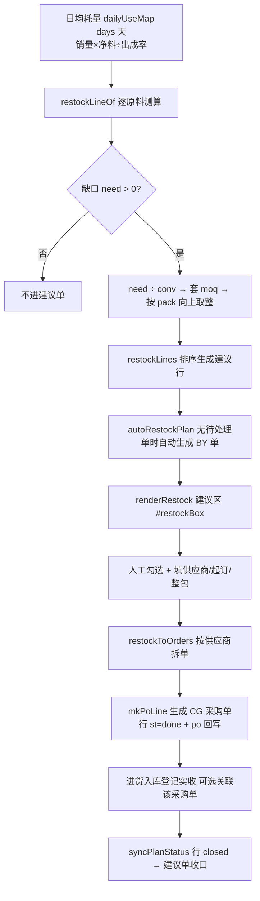

# 补货建议 模块设计

> 2026-09-21 新增，挂靠在「采购管理」页内（Tab `po` / 面板 `#tab-po`），**不新增独立 Tab**。
> 入口：`#tab-po` 工具条「🧮 补货建议」`#btnRestock`、「⚙ 补货参数」`#btnRestockCfg`；建议区容器 `#restockBox`。
> 数据：`DB.plans[]`（建议单）+ `DB.restock`（参数）；产出 `DB.orders`（采购单）。

## 1. 模块职责

按「销售出库日均耗量 + 提前期 + 配送间隔 + 安全库存」算出每个原料的**建议采购量**，
勾选后**按供应商拆成正式采购单（CG）**，形成「缺货预警 → 建议 → 下单 → 收货」闭环。

职责边界（三条硬规则）：

| # | 规则 |
|---|------|
| 1 | **只读取**：只读 `DB.ings` / `DB.sales`（经 `dailyUseMap`）/ `DB.orders`（在途量），**绝不触碰** `stock`/`avg`/`DB.recv`，不调用 `rebuildStock()` |
| 2 | **自动生成 ≠ 自动下单**：建议单可自动生成，**正式采购单只能由人工勾选后点「转采购单」生成** |
| 3 | **采购单不进库存**：与「采购管理」一致，转单只 `push DB.orders`，库存只认「进货入库」的实收 |

## 2. 核心流程图



## 3. 数据模型 / 接口契约

- 参数 `DB.restock`：`{days:30, lead:1, gap:1, useOnway:1}`
  - `days` 日均耗量统计天数；`lead` 提前期（下单→到货）；`gap` 配送间隔；`useOnway` 是否扣减在途
  - 读时兜底：`restockCfg()` = `Object.assign(RESTOCK_DEF(), DB.restock||{})`，**不升 `DB.v`、不换 `LS_KEY`**
- 建议单 `DB.plans[]`：
  ```
  {id:'BY..', no:'BY20260921-01', date, genAt, by:'auto'|'manual',
   status:'pending'|'part'|'closed'|'ignored',
   lines:[{ing, cur, safe, daily, onway, need, sug, unit, buy, conv,
           qty, price, supplier, st:'pending'|'done'|'closed'|'ignored', po}]}
  ```
  - `cur/safe/daily/onway/need` 均为**库存单位**；`sug/qty` 为**采购单位**
  - `price` 参考单价 = `ing.last || ing.avg×conv`（元/采购单位）
  - `st` 行状态：`pending` 待处理 → `done` 已转单 → `closed` 已收货；`ignored` 人工忽略
  - `po` 转出的采购单 id；采购单被删除时该行回退 `pending`
- 原料主数据**可选**字段：`sup` 默认供应商 / `moq` 起订量 / `pack` 整包规格（均为采购单位）
  - 在建议区填写后由 `readRestockRows()` 记回 `DB.ings`，转单时一并保存
- 关键函数：
  - `restockCfg()` 参数读取；`restockLineOf(g,use)` 单原料测算；`restockLines()` 全量测算（按缺口降序）
  - `autoRestockPlan()` 自动生成（无 `pending` 单才生成）；`genRestockPlan()` 手工重新测算
  - `renderRestock()` 建议区渲染；`readRestockRows()` 界面值回读
  - `restockToOrders()` 转采购单；`restockIgnore()` 忽略勾选
  - `syncPlanStatus()` 状态推进（挂在 `syncAllOrderRecv()` 末尾）
  - `openRestockCfg()` 参数面板；`planStTag()/lineStTag()` 状态标签

## 4. 关键设计决策 (ADRs)

- **ADR-5 挂采购管理内、不新增 Tab**：补货是「下单前的决策」，与采购单同源同供应商同单位体系；新增 Tab 会再引入一套导航/筛选/权限心智，收益不抵成本。
- **ADR-6 自动生成 ≠ 自动下单**：系统可以在无待处理建议单时自动算出建议（`autoRestockPlan()`，启动时与进入采购页时各挂一次），但**绝不自动 `push DB.orders`**——采购涉及真金白银的应付，必须人工确认。回归断言「自动生成后 `DB.orders.length === 0`」已固化此约束。
- **ADR-7 单位换算顺序**：`need(库存单位) ÷ conv → 套 moq → 按 pack 向上取整`。方案原文写的是「套 moq → pack → ÷ conv」，但 `moq/pack` 的语义是「最少起订 / 整包规格」，属于**采购单位**概念（如「最少 1 箱」「整包 5 袋」），放在换算后再施加才不会出现「除以 conv 后不足起订量」的错误。UI 已明写「（采购单位）」。
- **ADR-8 在途量防重复下单**：`openOrderQty(ingId)` 取未结案采购量（采购单位）乘 `conv` 折库存单位后扣减；作废单、已收齐行不计入。参数 `useOnway` 可关（有些店希望按「理想库存」而非「已下单」来补）。
- **ADR-9 结案闭环走派生，不加新字段**：建议单状态不落「是否收货」，而是跟着关联采购单的**收货进度**派生（`syncPlanStatus()` 读 `orderSt()`）；采购单删了行就回退 `pending`，不产生悬空引用。
- **ADR-10 新集合全部可选 + 读时兜底**：`DB.plans`/`DB.restock` 缺失时按空处理，`DB.ings` 无 `sup/moq/pack` 时按 0 处理，因此**未升 `DB.v`、未换 `LS_KEY`**（仍 `panda_inv_v3`），老数据直接可读。

## 5. 已知限制与风险

- 日均耗量依赖 `DB.sales` 与配方：无配方或无销售的原料，`daily=0`，此时**只按安全库存缺口**补货（可能偏保守）。
- 建议量是**参考值**，未考虑季节性波动、促销、现有可用量（净料/在制），人工复核仍是必要环节。
- 供应商为空时归到「未指定供应商」生成**一张**采购单；想拆单请先填供应商。
- 一个原料只有一行建议（`restockLines()` 按原料聚合），不区分「多个供应商报价更优」。
- `DB.plans` 会随时间累积，目前只展示**最新一张未忽略**的建议单，历史建议单无独立浏览/删除入口（可导出 JSON 备份后清理）。
- **双机同步**：`SYNC_COLL` 仍为旧集合，**不含 `plans`/`restock`/`orders`**（与「采购管理」已知限制同源），两端各生成的建议单在服务端合并时可能被整表覆盖；修复需与 `recv`/`orders` 一并处理。

## 6. 受保护逻辑

- `restockLineOf()` 的缺口公式与 `moq/pack` 取整顺序：改一处即影响所有建议量。
- `restockToOrders()` 的「只 push `DB.orders`、不调 `rebuildStock()`」：触碰即破坏库存红线。
- `dailyUseMap()`（销售出库口径）与 `openOrderQty()`（在途口径）：补货只消费不修改。

## 7. 变更记录

- 2026-09-21 新增模块（补货闭环方案 P3-17~22）：建议量算法、自动生成、按供应商转单、结案闭环、参数面板。
