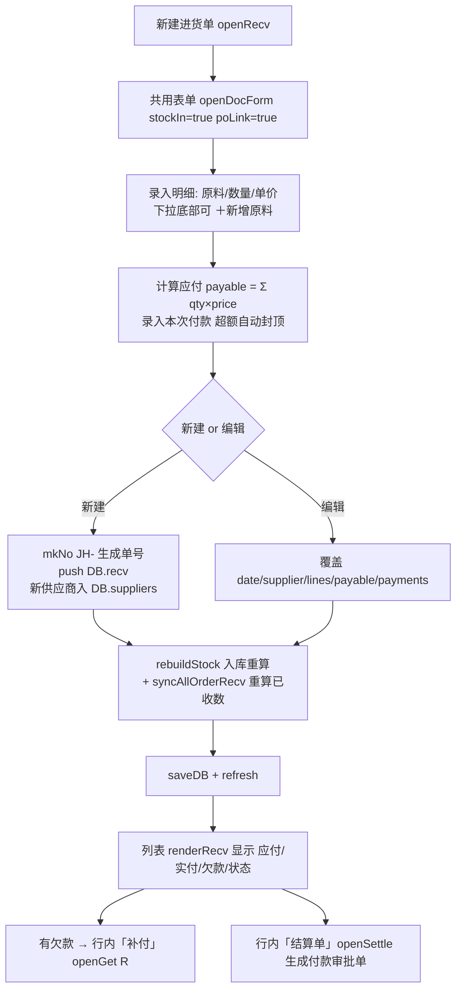

# 进货入库 模块设计

> 2026-09-16 由原「采购进货」模块拆分而来：**采购（下单）** 与 **进货（收货入库）** 分离。
> 本页管「供应商实际送来的货」，对应 Tab `buy` / 面板 `#tab-buy` / 数据 `DB.recv`。
> 下单请看 [采购管理.md](./采购管理.md)。结算单由本页单据生成，见 [结算单.md](./结算单.md)。

## 1. 模块职责

登记供应商实际送货（收货），**确认后立刻入库**并重算原料库存与移动加权均价，形成应付账款。这是库存重放的**唯一入库入口**（采购单不入库，见 [采购管理.md](./采购管理.md)）。

核心边界（与采购管理的分水岭）：

| 对比项 | 进货单 `DB.recv`（本模块） | 采购单 `DB.orders` |
|--------|------------------------------|--------------------|
| 业务含义 | 供应商**实际送货** | 向供应商**下单** |
| 是否入库 | **是**，确认即入库 | 否，不影响 `stock`/`avg` |
| 是否调用 `rebuildStock()` | **必须** | 禁止 |
| 是否产生库存流水 | 是（type 显示「采购入库」） | 否 |
| 单号前缀 | `JH-` | `CG-` |
| 记录 id 前缀 | `R` | `O` |

## 2. 核心流程图



## 3. 数据模型 / 接口契约

- 数据结构: `DB.recv[]`（与 `DB.orders` **字段结构完全一致**，差别只在归属数组、单号前缀、是否入库）
  ```
  {id:'R..', no:'JH20260912-01', date, supplier,
   lines:[{ing, qty, price, conv, amount, unitCost}],
   payable, payments:[{amount,date,method}], note, method,
   po?}                         -- po 为可选：关联的采购单 id（单向回流用）
  ```
  - `qty`/`price` 按**采购单位**；`unitCost = price / conv`（折库存单位单价）
  - `mkNo(prefix,date,i)`：`prefix + yyyymmdd + '-' + 序号`，序号按同日已有张数 +1
  - `payable = Σ amount`；付款上限 `Math.min(paid, payable)`
  - `po`：可选关联采购单 id；不关联也能正常入库（见第 5 节）
- 关键元素 / 函数：
  - DOM：工具条 `#btnNewRecv`、供应商筛选 `#recvSupplierFilter`、KPI `#buyKpi`、计数 `#recvCount`、表体 `#recvBody`
  - `openRecv(recv)` → `openDocForm(recv, null, cfg)`；
    `cfg = {title:'进货单', prefix:'JH', uidPre:'R', list:()=>DB.recv, stockIn:true, poLink:true, ...}`
  - `openDocForm(doc,presetIng,cfg)`：进货单与采购单**共用录入表单**，唯一差别即 `cfg.list()` 与 `cfg.stockIn`/`poLink`
  - 渲染：`renderRecv()` / `renderRecvKpi()` / `renderRecvFilter()`，全局筛选变量 `recvFilterSup`
  - 事件：`#recvBody` 委托 → `data-recvedit` / `data-recvdel` / `data-recvsettle` / `data-pay`
  - 删除：`delRecv(recv)`：`DB.recv` 过滤后 `rebuildStock()+syncAllOrderRecv()+saveDB()+refresh()`
  - 付款：`openGet('R', id)`（`'O'`=采购单、`'S'`=销售单）
  - KPI（renderRecvKpi）：本月进货应付 / 累计应付 / 累计实付 / 欠供应商
  - 明细行内新增原料：`openNewIngForPo(onOk)` → `createIngFromImport()`（库存/均价 0）

## 4. 关键设计决策 (ADRs)

- **ADR-1 确认即入库**：进货单是库存重放的唯一入库侧，保存即调用 `rebuildStock()`，保证移动加权均价只由真实收货驱动。
- **ADR-2 共用表单而非复制**：与采购单共用 `openDocForm` + `cfg`，差别收敛在 `list()` / `stockIn` / `poLink`，避免两份录入代码走样。两单字段结构完全一致。
- **ADR-3 历史数据归属**：旧 `DB.pos` 存的就是「已收货」（导出自实际配送单），`migrateV4()` 整批转 `DB.recv`，`DB.orders` 从空开始。
- **ADR-4 结算单挂在进货单上**：付款审批单以「实际收货」为对账基准，故结算单入口在进货单行内（见 [结算单.md](./结算单.md)），而非采购单。

## 5. 进货单 → 采购单 单向回流（2026-09-21 新增）

> 收货时通常知道「这批是哪个订单来的」，因此提供一条**单向**回流通道。

- 进货单新增**可选**字段 `po`（关联采购单 id）：`openDocForm()` 的「关联采购单」下拉（`poLink:true`），可留空。
- **单向**：只有「进货单 → 采购单」方向，采购单**不会**自动生成或约束进货单；关联只是**可选项**，不关联也能正常入库。
- 采购单侧因此新增**派生字段 `recvQty`（已收数）**：由 `syncOrderRecv(order)` 从 `DB.recv`（`recv.po` 命中该采购单的行）重算，
  **每次启动与每次进货单变动后全量重算（`syncAllOrderRecv()`），落地不采信、远端不采信**，与 `stock/avg` 同属派生值。
- 关联后采购单列表显示「已收 X / 下单 Y」进度；采购单**仍不入库**，库存始终只由进货单决定。
- 关键函数：`syncOrderRecv` / `syncAllOrderRecv` / `orderRecvProg` / `orderSt` / `orderLineSt`。
- 采购单状态体系（进行中/草稿/已结案/已作废 + 收货进度）详见 [采购管理.md](./采购管理.md) 第 7 节；本页只负责写入 `recv.po` 并触发 `syncAllOrderRecv()`。

## 6. 批量导入（进货单导入，2026-09-13 起）

> 入口：`#tab-buy` 工具条「📥 进货单导入」（支持 xlsx / 网页表格 / CSV / JSON，可手动指定列）；写库 `commitRecvImport()`。

- 与手工录入同源：`createIngFromImport`（遇新原料）→ `mkPoLine()` → 追加 `DB.recv`（`JH-` 单号）→ `rebuildStock()` → `saveDB()`。
- 新原料自动入库：`stock/avg=0`、`initStock=0`，单位取文件/默认「斤」，分类取文件/默认「其他」；导入后由 `rebuildStock()` 按移动加权平均生成均价。
- 付款：默认按实付标记（勾选「按应付全额」登记付款）。

## 7. 已知限制与风险

- **（重要）暂未纳入双机同步**：`SYNC_COLL = ['ings','dishes','pos','sales','quotes','logs']` 仍是旧的 `pos`，不含 `recv`/`orders`；`server/merge.py` 的 `COLL_KEY` 同样只有 `pos`。后果：本机新增的进货单/采购单在服务端合并时会被 `theirs` 整表覆盖（合并首行 `out.update(theirs)`），且因没有 `_u` 时间戳无法走记录级合并。修复方案（尚未实施，需 [EDIT_PLAN] 确认）：两处都改为 `recv`/`orders`。在此之前双机同时录单请以导出/导入 JSON 备份为准。
- 单张进货单无「部分入库」概念：收货以一张进货单为整批入库单位，实际分批到货请分多张进货单登记。
- `uid()` 仍是单机自增，跨机同后端 `DB.recv` 存在 id 冲突可能（见「数据同步与备份」已知限制）。

## 8. 受保护逻辑

- `rebuildStock()`：入库重放核心，调价/改量/删单后都由其重算，禁止直接修改。
- `syncAllOrderRecv()`：派生 `recvQty` 的唯一重算入口，任何单据变动后必须调用，落地值不可采信。
- `seedDB()`：真实历史数据落在 `DB.recv`（`RECV_SEED`，海南菜篮子实业 · 配送单号 BFXYVa2609100003 · 2026-09-12 · 89 行明细剔除未收货 5 项，实收 84 行），禁止替换为虚构数据。

## 9. 变更记录

- 2026-09-16 由「采购进货」拆分独立成文（`DB.pos` → `DB.orders` + `DB.recv`，新增本页与 `#tab-buy`）。
- 2026-09-21 新增进货单→采购单单向回流（`recv.po` + 派生 `recvQty`）、结算单入口挂本页单据。
