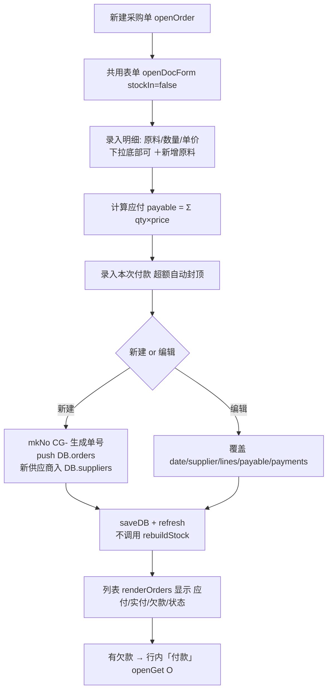

# 采购管理 模块设计

> 2026-09-16 由原「采购进货」模块拆分而来：**采购（下单）** 与 **进货（收货入库）** 分离。
> 本页管「向供应商下达的订单」，对应 Tab `po` / 面板 `#tab-po` / 数据 `DB.orders`。
> 收货与入库请看 [进货入库.md](./进货入库.md)。

## 1. 模块职责

向供应商下达采购单：记录单号/日期/供应商/明细行/付款，形成**应付账款**。

核心边界（与进货入库的分水岭）：

| 对比项 | 采购单 `DB.orders`（本模块） | 进货单 `DB.recv` |
|--------|------------------------------|------------------|
| 业务含义 | 向供应商**下单** | 实际**收货** |
| 是否入库 | **否**，不影响 `stock`/`avg` | 是，确认即入库 |
| 是否调用 `rebuildStock()` | **禁止** | 必须调用 |
| 是否产生库存流水 | 否 | 是（type 仍显示「采购入库」） |
| 单号前缀 | `CG-` | `JH-` |
| 记录 id 前缀 | `O` | `R` |

两页单据**各自独立编号、互不关联**：采购单不会自动转进货单，收货请到「进货入库」新建。

## 2. 核心流程图



## 3. 数据模型 / 接口契约

- 数据结构: `DB.orders[]`（与 `DB.recv` **字段结构完全一致**）
  ```
  {id:'O..', no:'CG20260916-01', date, supplier,
   lines:[{ing, qty, price, conv, amount, unitCost}],
   payable, payments:[{amount,date,method}], note, method}
  ```
  - `qty`/`price` 按**采购单位**；`unitCost = price / conv`（折库存单位单价）
  - `mkNo(prefix,date,i)`：`prefix + yyyymmdd + '-' + 序号`，序号按同日已有张数 +1
  - `payable = Σ amount`；付款上限 `Math.min(paid, payable)`
- 关键元素 / 函数：
  - DOM：工具条 `#btnNewOrder`、`#orderSupplierFilter`、`#orderCount`；KPI `#poKpi`；表体 `#orderBody`
  - `openOrder(order)` → `openDocForm(order, null, cfg)`；
    `cfg = {title:'采购单', prefix:'CG', uidPre:'O', list:()=>DB.orders, stockIn:false, ...}`
  - `openDocForm(doc,presetIng,cfg)`：进货单与采购单**共用录入表单**，唯一差别即 `cfg.list()` 与 `cfg.stockIn`
  - 渲染：`renderOrders()` / `renderOrderKpi()` / `renderOrderFilter()`，全局筛选变量 `orderFilterSup`
  - 事件：`#orderBody` 委托 → `data-orderedit` / `data-orderpay` / `data-orderdel`
  - 删除：`delOrder(order)`：`DB.orders` 过滤后 `saveDB()+refresh()`，**不重算库存**
  - 付款：`openGet('O', id)`（`'R'`=进货单、`'S'`=销售单）
  - 明细行内新增原料：`openNewIngForPo(onOk)` → `createIngFromImport()`（库存/均价 0）
  - 刷新入口：`refresh()` 中 `TAB==='po'` → `renderOrders()`
  - 补货建议宿主：本页工具条「🧮 补货建议」`#btnRestock`、「⚙ 补货参数」`#btnRestockCfg`，建议区 `#restockBox`
    （`renderOrders()` 末尾会先 `autoRestockPlan()` 再 `renderRestock()`），详见 [补货建议.md](./补货建议.md)

## 4. 关键设计决策 (ADRs)

- **ADR-1 为什么要拆**：原 `DB.pos` 一套单据既管下单又管入库，而店里的实际收货数常与下单数不同（缺货/改量），一张单无法同时表达「订单」与「实收」。拆分后 `DB.recv` 忠实反映实收（库存由此重放），`DB.orders` 忠实反映订单往来。
- **ADR-2 历史数据归属**：旧 `DB.pos` 的数据本来就是「已收货」（导出自实际配送单），因此 `migrateV4()` 整批转为 `DB.recv`，`DB.orders` 从空开始，避免与库存耦合。
- **ADR-3 共用表单而非复制**：两单的录入体验与数据结构一致，用一个 `openDocForm` + `cfg` 承载差异（`list()` 决定写哪、`stockIn` 决定是否 `rebuildStock()`），避免两份代码走样。
- **ADR-4 采购单不入插入库/不进流水**：库存只认实际收货。若允许订单入库，未到货部分会虚增库存、扭曲移动加权均价。

## 5. 已知限制与风险

- **（重要）暂未纳入双机同步：`SYNC_COLL = ['ings','dishes','pos','sales','quotes','logs']` 仍是旧的 `pos`**，不含 `recv`/`orders`；`server/merge.py` 的 `COLL_KEY` 同样只有 `pos`。后果：本机新增的进货单/采购单在**服务端合并时会被 `theirs` 整表覆盖**（`merge()` 首行 `out.update(theirs)`），且因没有 `_u` 时间戳而无法走记录级合并。修复方案（尚未实施，需 [EDIT_PLAN] 确认）：两处都改为 `recv`/`orders`。在此之前双机同时录单请以导出/导入 JSON 备份为准。
- `orders` 无批量导入通道，只能手工录入（如需，可复用 `readImportFile(f,'po')` 的解析链，落 `DB.orders`）。
- 采购单与实际收货无自动勾稽：两者不对选定会自动提示，需人工在「进货入库」核对。
- 单张采购单无「收货状态」（部分收货/已收货）字段。
- `uid()` 仍是单机自增，跨机同后端 `DB.orders` 存在 id 冲突可能（见「数据同步与备份」已知限制）。
- `LS_KEY` 仍为 `panda_inv_v3`（`DB.v` 已升级到 4，但未换 key），旧数据靠 `init()` 中的 `migrateV4()` 兼容升级。

## 6. 受保护逻辑

- `openDocForm()` 中与进货单共用的明细行计算（`conv/amount/unitCost`）与 `cfg.stockIn` 分支，调整前须确认两个 Tab 的行为。
- `rebuildStock()`：本模块**不得调用**，也无流水产生。
- `seedDB()`：真实历史数据落在 `DB.recv`（`RECV_SEED`，海南菜篮子实业 · 配送单号 BFXYVa2609100003 · 2026-09-12 · 89 行明细剔除未收货 5 项，实收 84 行），禁止替换为虚构数据。

## 7. 采购单状态体系与单向回流（2026-09-21 新增）

### 7.1 采购单状态体系
采购单是订单往来，**不入库**，其生命周期用状态表达：

| 状态 | 取值 | 触发 | 说明 |
|---|---|---|---|
| 进行中 | `normal` | 默认 / 关联进货单被删除后回退 | 未收齐 |
| 草稿 | `draft` | 草稿态 | 尚未正式下达 |
| 已结案 | `closed` | 手动「结案」，或**所有明细行已收齐自动结案** | 不再计入在途量 |
| 已作废 | `void` | 手动「作废」 | 不计入在途量；可「恢复」回 `normal` 并重算 |

- 行状态 `orderLineSt(l)`：`normal`（未收/部分收）/ `closed`（已收齐）/ `canceled`（随单作废）；下单量 `qty` 与已收 `recvQty` 收齐即视为该行结案。
- `orderSt(p)`：综合单头 `status` 与各行状态得出整单状态；列表显示「收货中 / 已结案 / 已作废 / 草稿」标签与「已收 X / 下单 Y」进度。
- 作废/结案/恢复/删除后都会走 `syncAllOrderRecv()` 重算，**不调用 `rebuildStock()`**（采购单不进库存是硬红线）。
- 采购页新增「收货状态」列与状态筛选（全部 / 进行中 / 已结案 / 已作废）。

### 7.2 进货单 → 采购单 单向回流
- 进货单可选关联采购单（`recv.po`），**单向**只回写收货状态，不约束进货单；不关联也能正常入库（详见 [进货入库.md](./进货入库.md) 第 5 节）。
- 采购单派生 `recvQty`（已收数）由 `syncOrderRecv(order)` 从 `DB.recv` 重算，**每次启动与每次进货单变动后全量重算（`syncAllOrderRecv()`）**，落地/远端均不采信。
- 该状态同时驱动 [补货建议.md](./补货建议.md) 的结案闭环：建议行关联采购单收齐 → 行 `closed` → 建议单收口。
- 关键函数：`orderSt` / `orderLineSt` / `orderStTag` / `orderRecvProg` / `syncOrderRecv` / `syncAllOrderRecv` / `setOrderLinesSt` / `openOrderQty`（未结案采购量，供补货建议在途量）。

## 8. 补货建议（挂本页内，2026-09-21 新增）

- 本页是「补货建议」的宿主：建议区 `#restockBox` 位于采购单列表下方，测算/转单都在本页完成，**不新增 Tab**。
- 三类单据的关系：`DB.plans`（建议 BY）→ 人工勾选转单 → `DB.orders`（采购 CG）→ `DB.recv`（收货 JH，入库）。
- **自动生成 ≠ 自动下单**：进入本页或系统启动时可能自动生成建议单，但采购单**只能**由人工点「转采购单」生成。
- 转单时按建议行的「供应商」拆成多张采购单，采购量沿用建议量（可改），单价取原料 `last`（无则 `avg×conv`）。
- 采购单被删除时，关联的建议行回退为「待处理」，不会留下悬空引用。
- 完整设计与参数口径见 [补货建议.md](./补货建议.md)。

## 9. 变更记录

- 2026-09-16 由「采购进货」拆分独立成文（`DB.pos` → `DB.orders` + `DB.recv`，新增本页与 `#tab-po`）。
- 2026-09-21 新增采购单状态体系（进行中/草稿/已结案/已作废 + 收货进度）、进货单→采购单单向回流、补货建议宿主说明。
