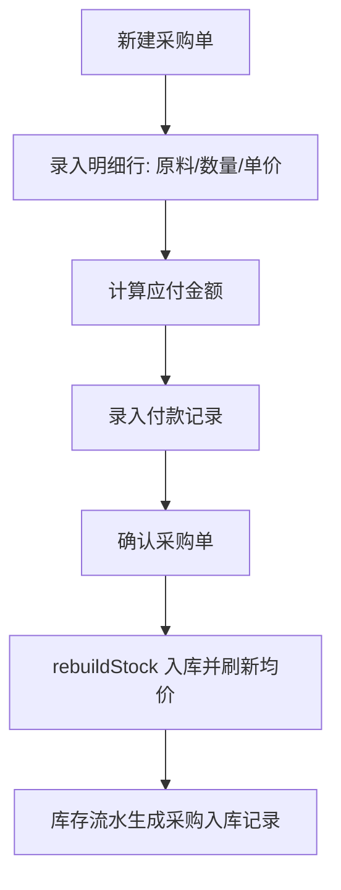

# 采购进货 模块设计

> ⚠️ **本文档为历史模块文档（v1.4 及以前）**。2026-09-16 起「采购进货」已拆分为两个模块：
> - **采购（下单）** → [采购管理.md](./采购管理.md)：`DB.orders`，单号 `CG-`，**不入库**
> - **进货（收货）** → [进货入库.md](./进货入库.md)：`DB.recv`，单号 `JH-`，确认即入库
>
> 下文中的 `DB.pos` / `openPo()` / `#tab-buy` 均已随拆分更名，仅作历史决策留档；
> 第 1~7 节的**业务口径**（换算率、应付/付款、批量导入规则）仍然有效，请以新文档为准对照阅读。
>
> ⚠️ **第 8、9 节原为拆分后补写的「进货单→采购单单向回流」「采购单状态体系」**，现已分别并入
> [进货入库.md](./进货入库.md) 第 5 节（单向回流）与 [采购管理.md](./采购管理.md) 第 7 节（状态体系），
> 本文第 8、9 节仅保留要点索引，避免与现行文档重复漂移。

## 1. 模块职责
录入采购单(供应商/日期/明细行/付款)，确认后自动入库并刷新原料库存均价。支持欠款与后续补付。
（拆分后：下单侧见 [采购管理.md](./采购管理.md)，入库侧见 [进货入库.md](./进货入库.md)）

## 2. 核心流程图


## 3. 数据模型 / 接口契约
- 数据结构: `DB.pos[]`
  ```
  {id, no, date, supplier, lines:[{ing,qty,price,conv,amount,unitCost}], payable, payments:[{amount,date,method}], note, method}
  ```
- 入库单价 = 采购价 / 换算率(conv)
- 关键函数: `renderBuy()`、`mkPoLine(g,q,p)`、`mkNo(prefix,date,i)`

## 4. 关键设计决策 (ADRs)
- 采购单确认即入库，无草稿态（当前实现）
- 已入库采购单不可直接修改数量，需删除重建（避免库存红冲漂移）
- 真实数据基线: 1单84行，海南菜篮子实业 2026-09-12，配送单号 BFXYVa2609100003

## 5. 已知限制与风险
- 无采购退货/红冲流程，退货需手工盘点调整
- 供应商列表当前仅「海南菜篮子实业有限公司」，新增供应商需在采购单录入时添加

## 6. 受保护逻辑
- `seedDB()` 中的 PO_SEED 真实采购数据，禁止替换为虚构数据

## 7. 批量导入（2026-09-13 新增）

- 入口：`#tab-buy` 工具条「📥 批量导入采购单」+「下载导入模板」，文件框 `#filePoImport`
- 支持格式：`.csv`（Excel「另存为 CSV」，自动兼容 UTF-8 / GBK）、`.json`（`{supplier,date,note,lines:[{ingName,qty,price}]}`，或 `{pos:[...]}` 多单）
- CSV 列：`供应商 / 日期 / 原料名称 / 数量 / 单价 / 备注`（供应商、日期、备注可空；日期支持 `2026/9/13` 等写法）。同一「供应商+日期」的行自动合并为一张采购单
- 流程：`readImportFile → parsePoInput → previewPoImport（预览确认）→ commitPoImport（写库）`
- 写库路径与手工录入完全同源：`createIngFromImport`（如遇新原料）→ `mkPoLine()` → 追加 `DB.pos` → `rebuildStock()` → `saveDB()`
- **新原料自动入库**：原料按名称精确匹配，未匹配到即新建原料（`stock/avg=0`、`initStock=0`，单位取文件/默认「斤」，分类取文件/默认「其他」）；导入后由 `rebuildStock()` 按移动加权平均生成均价
- 付款：默认挂账（`payments:[]`），预览页可勾选「按应付全额登记付款」
- 关键函数：`parsePoInput()`、`previewPoImport()`、`commitPoImport()`、`downloadPoTemplate()`
- 约束：**只**在 `commitPoImport()` 内写 `DB.pos`/`DB.ings`/`DB.suppliers`；预览阶段（`previewPoImport`）不得产生任何写库副作用；无 XLSX 解析库，不支持 `.xlsx` 直传
- 未改动：手工「新建采购单」`openPo()` 一行未改

## 8. 进货单 → 采购单 单向回流（要点索引）

> 详见 [进货入库.md](./进货入库.md) 第 5 节。

- 进货单可选关联采购单（`recv.po`），**单向**只回写收货状态，不约束进货单；采购单派生 `recvQty` 由 `syncAllOrderRecv()` 从 `DB.recv` 重算。
- 关键函数：`syncOrderRecv` / `syncAllOrderRecv` / `orderRecvProg` / `openOrderQty`（未结案采购量，供补货建议在途量）。

## 9. 采购单状态体系（要点索引）

> 详见 [采购管理.md](./采购管理.md) 第 7 节。

- 状态：`normal`(进行中) / `draft`(草稿) / `closed`(已结案) / `void`(已作废)；行状态 `orderLineSt()`：`normal`/`closed`/`canceled`。
- 作废/结案/恢复/删除后走 `syncAllOrderRecv()` 重算，**不调用 `rebuildStock()`**（采购单不进库存是硬红线）。
- 该状态同时驱动 [补货建议.md](./补货建议.md) 的结案闭环。
