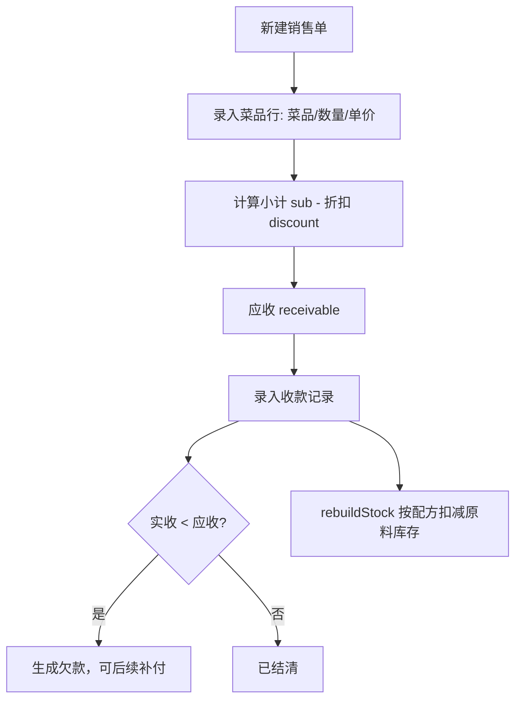

# 销售收银 模块设计

## 1. 模块职责
录入销售单(渠道/菜品/数量/单价/折扣/收款)，确认后按配方(BOM)自动扣减原料库存。应收−实收=客户欠款，可分次收款。

## 2. 核心流程图


## 3. 数据模型 / 接口契约
- 数据结构: `DB.sales[]`
  ```
  {id, no, date, ch, lines:[{dish,qty,price,amount}], sub, discount, receivable, payments:[{amount,date,method}], note, cost}
  ```
- 应收 = 售价合计 - 折扣
- 欠款 = 应收 - 实收(付款记录合计)
- 食材成本 = 按配方(BOM) × 销售数量 × 原料均价
- 关键函数: `renderSale()`、`calcSaleCost(s)`

## 4. 关键设计决策 (ADRs)
- 当前 S_SEED 为空（暂无真实销售数据），开业后录入
- 渠道: 堂食/外卖
- 收款方式: 现金/扫码/平台结算
- 销售单确认后按配方扣库存，无配方的菜品不扣库存

## 5. 已知限制与风险
- 无配方(BOM)的菜品销售时不扣减原料库存，库存会虚高
- 无销售退货流程，退货需手工盘点调整
- 折扣为整单折扣，不支持单行折扣

## 6. 外部销售数据接入（美团等平台，2026-09-21 新增）

> 目标：把美团等外卖平台导出的销售明细**直接落 `DB.sales`**，与手工销售单同链路参与库存扣减与真实毛利核算。
> 入口：`#tab-sale` 工具条「📥 导入平台销售」「🔁 导入批次」「⚙ 金额口径重算」「🏷 菜名映射」+ 隐藏文件框 `#fileSaleImport`。

- **渠道扩展**：`SALE_CHS` 新增「美团外卖」；`openSale()` 渠道下拉与销售页渠道筛选同步；列表对外部单显示平台来源与批次号。
- **手工录入**：复用「＋新建销售单」，新增可选「平台订单号」（写 `srcNo`，供幂等去重）。
- **列定义** `IMP_SALE_DEFS`（13 列）：`dish`/`qty` 必填；`date`/`orderNo`/`price`/`amtList`/`amtPaid`/`amtNet`/`amtFee`/`amtPromo`/`note` 可选。
- **两种解析模式**（自动嗅探）：有订单号 → `detail`（按订单号拆单）；无订单号 → `sum`（按日期汇总，默认）。
  - `detail` 模式默认**按整单取首行**取金额（平台导出的订单级金额在多行重复，按行求和会翻倍）；预览提供「按行求和」开关。
- **三级菜名匹配** `matchSaleDish()`：别名 → 精确 → 归一化（`normDishName` 去空格/括号规格/标点）；**不做模糊包含**，避免误配导致错误扣库存。
- **未匹配菜品**进「待映射」清单，预览里指定菜品后自动 `setDishAlias()` 记别名（含份量系数 `mul`）；别名可在「🏷 菜名映射」里管理（列表 / 删除 / 新增）。
- **金额口径** `resolveSaleAmt()`（A~E 五档，可事后重算）：

  | 档 | 条件 | 取法 |
  |---|---|---|
  | A | 用户实付 + 商家实收都有 | `receivable = 商家实收`，`discount = 原价 − 实收` |
  | B | 仅用户实付 | 按用户实付推 |
  | C | 仅商家实收 | 按商家实收推 |
  | D | 原价 + 优惠/扣费 | 原价减扣费 |
  | E | 兜底 | 单价 × 数量 |

  扣费与优惠**统一进 `discount`**；冗余存 `amtMode` + `srcAmt`。
- **销售单内部一致性**：`sub = Σ 行 qty×price`，`receivable = 商家实收`，`discount = sub − receivable`（< 0 夹 0）；无单价时按数量占比反推单价。
- **幂等 + 整批撤回**：`saleDupKeyOf()`（明细取 `srcNo`、汇总取 `@日期`）× `src` 去重；「🔁 导入批次」可整批撤回后重放。
- **三段式**：`parseSaleTable/parseSaleJson` → `previewSaleImport`（**禁写库**）→ `commitSaleImport`（**唯一写入口**）。
- **未结算**：未勾选「已结算」→ `payments=[]`，形成平台待结算欠款，列表状态显示「待平台结算」，后续用「收款」补登记。
- **事后重算** `openSaleAmtRecalc/applySaleAmtRecalc`：只改 `sub/discount/receivable`，**不动明细数量、不调 `rebuildStock()`**；与导入共用 `resolveSaleAmt`，两处口径永远一致。
- **新增字段全部可选**：`src` / `srcNo` / `batch` / `amtMode` / `srcAmt` / `settled`，**未升 `DB.v`、未动 `LS_KEY`**。
- 导入后由 `rebuildStock()` 按配方扣减库存（与手工销售单同一链路），采购单 / 进货单不受影响。
- 关键函数：`matchSaleDish` / `resolveSaleAmt` / `buildSaleDocs` / `parseSaleTable` / `previewSaleImport` / `commitSaleImport` / `saleDupKeyOf` / `delSaleBatch` / `openSaleAmtRecalc` / `openAliasMap`。

## 7. 受保护逻辑
- `calcSaleCost()` 销售成本核算逻辑
- `commitSaleImport()` 是外部销售数据的**唯一写入口**：预览阶段禁止写库；任何新接入平台都必须走「解析 → 预览 → 确认」三段式
